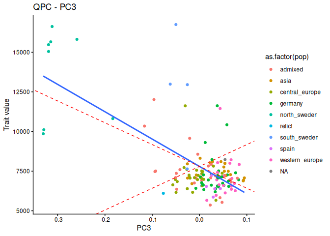
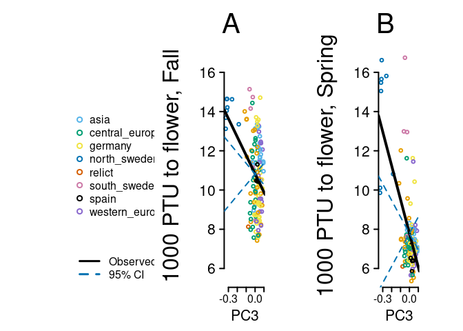
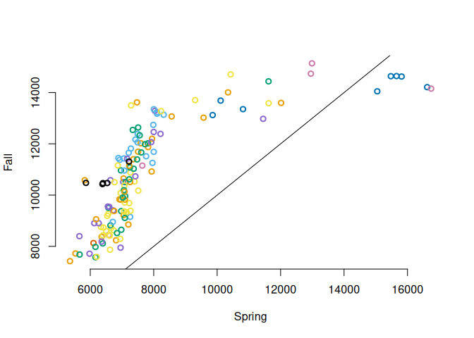
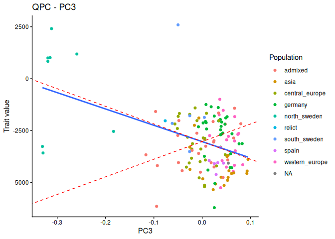
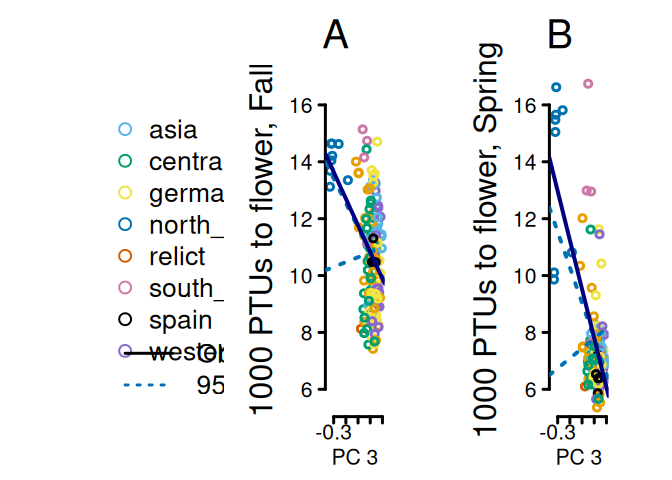
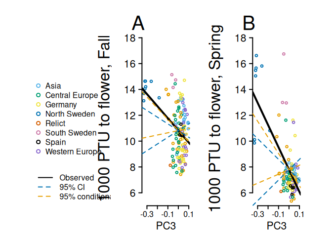
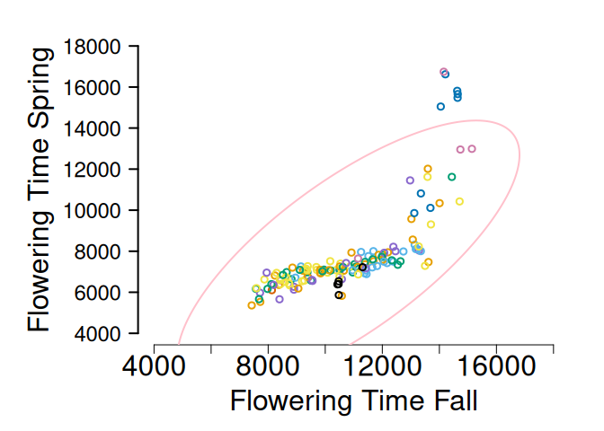

Load in FIBR data and extract Norwich data

``` r
fibrdat = read.table('data/alldat_ecomatches_replicate_ecotype_names_reduced.txt', header=T, stringsAsFactors = F)
NF6 <- dplyr::filter(fibrdat,planting=='NorwichFall2006')
NS7 <- dplyr::filter(fibrdat,planting=='NorwichSpring2007')

## pull out the Norwich data
norS7F6 = as.data.frame(fibrdat
                          %>% dplyr::filter(planting %in% c('NorwichFall2006', 'NorwichSpring2007'))
                          %>% filter(ecotype_id != 'no_match')%>% filter(!is.na(ecotype_id)) 
                          %>% dplyr::select(planting,Ecotype,ecotype_id, dtb_ptu, Blk, Latitude, Longitude, Sil_Num_With_0s) 
                          %>% group_by(Ecotype, planting) %>% summarise(dtbMean = mean(dtb_ptu, na.rm=T), ecotype_id = first(ecotype_id), latitude = first(Latitude), longitude=first(Longitude)))

#make a dataframe with the mean ptu to flowering
norAll = as.data.frame(spread(norS7F6, planting, dtbMean))
```

Make kinship matrices

``` r
#system("python3 process_snp_matrix.py -i 1001_SNP_MATRIX/imputed_snps_binary.hdf5 -o 1001-matrix-50Ksamp -n 50000") ##read in SNP data from 1001 genomes and subsample using a pythong script
myG = read.table('data/1001-matrix-50Ksamp', header=T, stringsAsFactors = F)

## get ecotypes with data in both environments
norAllnomissing = na.omit(norAll)

#merge in the data about population grouping
accDat <- read.csv('data/1001genomes-FT10-FT16 and 1001genomes-accessions.csv')
accDat$ecotype_id = as.character(accDat$id)
accDat2 = accDat[!duplicated(accDat$ecotype_id),c(18,15)] #remove duplicates and columns we don't care about
allDat = droplevels(dplyr::left_join(norAllnomissing, accDat2, by='ecotype_id')) #merge with the norwich trait data

knames = sapply( names(myG)[-1] ,  function(x){substring(x,2)}) #get names of individuals
myGt = data.frame(ecotype_id = knames, t(myG[,-1]), stringsAsFactors = F) #make a table of the transposed genotype matrix
myGmerge = dplyr::inner_join(allDat, myGt, by = 'ecotype_id') #merge with the phenotype dataset
myK = make_k(as.matrix(myGmerge[,-c(1:7)])) #make kinship matrix
myEig = eigen(myK) #eigen decomposition
plantDat = myGmerge[,1:7]#get the other data in the same order as the kinship matrix


#save the file to use later
save(myEig, myK, plantDat, file = "data/Norwich_qpc_inputs.rda")
```


Test for selection in Norwich

``` r
load('data/Norwich_qpc_inputs.rda')

# Norwich fall 2006
myQpc_NF6 = calc_qpc(trait_values = plantDat$NorwichFall2006, eigen_k = myEig, test_pcs = 1:5, var_pcs=70:140)
plot_qpc(qpc= myQpc_NF6, trait_values = plantDat$NorwichFall2006, eigen_k=myEig, pop_labels = plantDat$group, test_pcs = 3)
```

```
## [[1]]
```

<!-- -->

``` r
myQpc_NF6$pvals*length(myQpc_NF6$pvals) #get pvalues (bonf corrected)
```

```
## [1] 0.762580330 1.570475007 0.006059836 2.851979905 3.914695596
```

``` r
#Norwich spring 2007
myQpc_NS7 = calc_qpc(trait_values = plantDat$NorwichSpring2007, eigen_k = myEig, test_pcs = 1:5, var_pcs=70:140)
plot_qpc(qpc= myQpc_NS7, trait_values = plantDat$NorwichSpring2007, eigen_k=myEig, pop_labels = plantDat$group, test_pcs = 3)
```

```
## [[1]]
```

<!-- -->

``` r
myQpc_NS7$pvals*length(myQpc_NF6$pvals) #get pvalues (bonf corrected)
```

```
## [1] 3.9285150433 2.7253684974 0.0007245085 3.9720526437 4.1050533899
```


Test for selection on the reaction norm between spring and fall in Norwich


``` r
plantDat$rn = plantDat$NorwichSpring2007 - plantDat$NorwichFall2006 #calculate the reaction norm. Positive values mean later flowering in spring plantings. Negative values mean later flowering in fall plantings.

par(mfrow=c(1,1))
hist(plantDat$rn, col = mycol[3], border="white", xlab = "", main="PTU Spring - Fall")
```

<!-- -->

``` r
## most are negative which makes sense since the fall plants had to overwinter.

plot(plantDat$NorwichSpring2007, plantDat$NorwichFall2006, col = as.factor(plantDat$group), bty="n", xlab = "Spring", ylab="Fall", lwd=2)
cor.test(plantDat$NorwichFall2006, plantDat$NorwichSpring2007)
```

```
## 
## 	Pearson's product-moment correlation
## 
## data:  plantDat$NorwichFall2006 and plantDat$NorwichSpring2007
## t = 13.252, df = 139, p-value < 2.2e-16
## alternative hypothesis: true correlation is not equal to 0
## 95 percent confidence interval:
##  0.6637866 0.8121249
## sample estimates:
##       cor 
## 0.7471162
```

``` r
abline(a = 0, b=1)
```

<!-- -->

``` r
## You can see a tail of accessions that need vernalization.

#calculate qpc on the reaction norm (only doing pc 3)
myQpc_rn = calc_qpc(trait_values = plantDat$rn, eigen_k = myEig, test_pcs = 1:3, var_pcs=70:140)
plot_qpc(qpc= myQpc_rn, trait_values = plantDat$rn, eigen_k=myEig, pop_labels = plantDat$group, test_pcs = 3)
```

```
## [[1]]
```

<!-- -->

``` r
myQpc_rn$pvals[3]
```

```
## [1] 0.07381048
```


Conditional test on the reaction norm


``` r
myQcondrn = calc_cond_qpc(focal_trait=plantDat$rn, cor_trait=(plantDat$NorwichSpring2007 + plantDat$NorwichFall2006)/2, eigen_k=myEig, test_pcs = 3, var_pcs = 70:140) #do the conditional test just for PC3
myQcondrn$pvals
```

```
##           [,1]
## [1,] 0.4390403
```

``` r
plot_cond_qpc(cond_qpc = myQcondrn, eigen_k=myEig, trait_values = plantDat$rn, test_pcs=3, pop_labels = plantDat$group)
```

```
## [[1]]
```

<!-- -->


The conditional test on the correlated traits view

``` r
#test for selection on Norwich spring given Norwich fall

myQcondNS7 = calc_cond_qpc(focal_trait = plantDat$NorwichSpring2007, cor_trait = plantDat$NorwichFall2006, eigen_k = myEig, test_pcs = 3, var_pcs = 70:140)
myQcondNS7$pvals #get the p value
```

```
##             [,1]
## [1,] 0.000898521
```

``` r
#selection on Norwich fall given norwich spring
myQcondNF6 = calc_cond_qpc(cor_trait = plantDat$NorwichSpring2007, focal_trait = plantDat$NorwichFall2006, eigen_k = myEig, test_pcs = 3, var_pcs = 70:140)
myQcondNF6$pvals #get the p value
```

```
##            [,1]
## [1,] 0.01280981
```


``` r
## making figures of the conditional test

#get CIs for each comparison
myCI_fs = 1.96*sqrt(myQcondNF6$cond_va*myEig$values)
myCI_sf = 1.96*sqrt(myQcondNS7$cond_va*myEig$values)


cfibrfig <-function(){
#legend('left', levels(plantDat$group)[-1], pch=1, pt.lwd = 2,col = palette()[-1], bty="n", text.width = 0.04, cex=2.5)
  plot.new()
legend('left', c("Asia","Central Europe","Germany","North Sweden","Relict","South Sweden", "Spain","Western Europe"), pch=1, pt.lwd = 2,col = palette()[-1], bty="n", text.width = 0.04, cex=1.5)
  legend('bottomleft', c('Observed','95% CI', '95% conditional CI'), lty = c(1,2,2),lwd = 2,col = c('black','#0072B2',"#E69F00"), bty="n", text.width = 0.04, cex=1.5)

plot(myEig$vectors[,3], plantDat$NorwichFall2006[-nrow(plantDat)], bty="n", col = as.factor(plantDat$group), lwd=2, ylab = "", yaxt="n",xlab = "PC3", cex.lab=2, cex.axis=2, xaxt="n", ylim = c(5500, 18000))
axis(1, cex.axis=1.5, lwd=2)
axis(2, las=2, cex.axis=2, lwd=2, at = seq(6000, 18000, by = 2000), lab = seq(6, 18, by=2))
mtext('1000 PTU to flower, Fall',side=2, line=5, cex=2)
par(xpd=F)
myl = lm(myQcondNF6$mu_cond~myEig$vectors[,3]) ##conditional expectation of the relationsip
abline(lm(plantDat$NorwichFall2006[-nrow(plantDat)]~myEig$vectors[,3]), lwd=4, col = "black")
abline(a=mean(plantDat$NorwichFall2006), b = myCI_fs[3], lty=2, col='#0072B2', lwd=2)
abline(a=mean(plantDat$NorwichFall2006), b = -myCI_fs[3], lty=2, col='#0072B2', lwd=2)
abline(a=mean(plantDat$NorwichFall2006), b = myl$coefficients[2] + myCI_fs[3], lty=2, col="#E69F00", lwd=2)
abline(a=mean(mean(plantDat$NorwichFall2006)), b = myl$coefficients[2] -myCI_fs[3], lty=2, col="#E69F00", lwd=2)
mtext('A', side=3, line=0, cex=2.5, adj = -0.3)

plot(myEig$vectors[,3], plantDat$NorwichSpring2007[-nrow(plantDat)], bty="n", col = as.factor(plantDat$group), lwd=2, ylab = "", yaxt="n",xlab = "PC3", cex.lab=2, cex.axis=2, xaxt="n", ylim = c(5500, 18000))
axis(1, cex.axis=1.5, lwd=2)
axis(2, las=2, cex.axis=2, lwd=2, at = seq(6000, 18000, by = 2000), lab = seq(6, 18, by=2))
mtext('1000 PTU to flower, Spring',side=2, line=5, cex=2)
mylb = lm(myQcondNS7$mu_cond~myEig$vectors[,3]) ##conditional expectation of the relationship
abline(lm(plantDat$NorwichSpring2007[-nrow(plantDat)]~myEig$vectors[,3]), lwd=4, col = "black")
abline(a=mean(plantDat$NorwichSpring2007), b = myCI_sf[3], lty=2, col='#0072B2', lwd=2)
abline(a=mean(plantDat$NorwichSpring2007), b = -myCI_sf[3], lty=2, col='#0072B2', lwd=2)
abline(a=mean(mean(plantDat$NorwichSpring2007)), b = mylb$coefficients[2] + myCI_sf[3], lty=2, col="#E69F00", lwd=2)
abline(a=mean(mean(plantDat$NorwichSpring2007)), b = mylb$coefficients[2] -myCI_sf[3], lty=2, col="#E69F00", lwd=2)
mtext('B', side=3, line=0, cex=2.5, adj = -0.3)
}
par(mar = c(5,5,5,5), xpd=T, mfrow=c(1,3))
cfibrfig()
```

<!-- -->


``` r
postscript("figures/FIBRfig.eps",height=7,width=12,paper="special",horizontal=FALSE,colormodel="cymk")
par(mar = c(5,5,5,5), xpd=T, mfrow=c(1,3))

cfibrfig()

dev.off()
```

```
## png 
##   2
```


Make a figure of correlation between the two traits compared to expectation under selection on one trait and correlated selection on the other.


``` r
par(mar=c(5,8,2,2))
plantDat$group <- as.factor(plantDat$group) 

myZ <- data.frame(NF6 = plantDat$NorwichFall2006, NS7 = plantDat$NorwichSpring2007,stringsAsFactors = F)

#make the g matrix
makeG <- function(myZ){
  myZ1centered = (myZ[-nrow(myZ), 1] - mean(myZ[, 1])) 
    myZ2centered = (myZ[-nrow(myZ), 2] - mean(myZ[, 2]))
     Ca12 = sum(myZ1centered * myZ2centered)/nrow(myZ-1)
     Va1 <- sum(myZ1centered*myZ1centered)/nrow(myZ-1)
     Va2 <- sum(myZ2centered*myZ2centered)/nrow(myZ-1)
    myG <- matrix(data=c(Va1, Ca12, Ca12,Va2), ncol=2)
    return(myG)
}
myG <- makeG(myZ) #make it from just phenotypes

ellipse <- function(mu, sigma, alpha=.05, npoints=250,
                    newplot=FALSE, draw=TRUE, ...) {
  es <- eigen(sigma)
  e1 <- es$vec%*%diag(sqrt(es$val))
  r1 <- sqrt(qchisq(1-alpha,2))
  theta <- seq(0,2*pi,len=npoints)
  v1 <- cbind(r1*cos(theta),r1*sin(theta))
  pts=t(mu-(e1%*%t(v1)))
  if (newplot && draw) {
    plot(pts, ...)
  } else if (!newplot && draw) {
    lines(pts, ...)
  }
  invisible(pts)
}

par(mfrow=c(1,1))
plot(plantDat$NorwichFall2006, plantDat$NorwichSpring2007, bty="n", col = as.factor(plantDat$group), lwd=2, yaxt="n",xlab = "Flowering Time Fall", cex.lab=2, cex.axis=2, ylab = "", ylim = c(4e3, 18e3), xlim=c(4e3, 18e3))
axis(2, las=2, cex.axis=1.5, lwd=2)
mtext('Flowering Time Spring',side=2, line=5, cex=2)
ellipse(mu=c(mean(myZ$NF6), mean(myZ$NS7)), myG,col="pink",lwd=2, alpha=0.01)
```

<!-- -->


```
## png 
##   2
```
