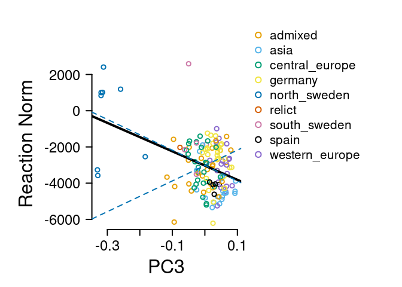

Load in FIBR data

``` r
fibrdat = read.table('data/alldat_ecomatches_replicate_ecotype_names_reduced.txt', header=T, stringsAsFactors = F)
```


``` r
## pull out the Norwich data
norS7F6 = as.data.frame(fibrdat
                          %>% dplyr::filter(planting %in% c('NorwichFall2006', 'NorwichSpring2007'))
                          %>% filter(ecotype_id != 'no_match')%>% filter(!is.na(ecotype_id)) 
                          %>% dplyr::select(planting,Ecotype,ecotype_id, dtb_ptu, Blk, Latitude, Longitude, Sil_Num_With_0s) 
                          %>% group_by(Ecotype, planting) %>% summarise(dtbMean = mean(dtb_ptu, na.rm=T), ecotype_id = first(ecotype_id), latitude = first(Latitude), longitude=first(Longitude)))
```

```
## `summarise()` has grouped output by 'Ecotype'. You can override using the
## `.groups` argument.
```

``` r
#make a dataframe with the mean ptu to flowering
norAll = as.data.frame(spread(norS7F6, planting, dtbMean))
```


``` r
##make a map
library(maps)

mylat = as.numeric(norAll$latitude)
```

```
## Warning: NAs introduced by coercion
```

``` r
mylong = as.numeric(norAll$longitude)
```

```
## Warning: NAs introduced by coercion
```

``` r
map("world", xlim=c(-20,50), ylim=c(20, 80), fill=T, col="azure")

points(mylong,mylat, pch=16, cex=0.5, col="darkred")
box()
```

<!-- -->


Make kinship matrices

``` r
##read in SNP data from 1001 genomes
#system("python3 process_snp_matrix.py -i 1001_SNP_MATRIX/imputed_snps_binary.hdf5 -o 1001-matrix-50Ksamp -n 50000")
myG = read.table('data/1001-matrix-50Ksamp', header=T, stringsAsFactors = F)

knames = sapply( names(myG)[-1] ,  function(x){substring(x,2)})
myGt = data.frame(ecotype_id = knames, t(myG[,-1]), stringsAsFactors = F)

## for the norwich datasets 
getK <- function(myDataSet, myGtable, id = "ecotype_id", skipcol=3){
myGmerge = dplyr::inner_join(myDataSet, myGtable, by = 'ecotype_id')
myK = make_k(as.matrix(myGmerge[,-c(1:skipcol)]))
myEig = eigen(myK)
myData = myGmerge[,1:skipcol]
return(list(k = myK, eig = myEig, dat = myData))}


## get ecotypes with data in both
norAllnomissing = na.omit(norAll)
Norstuff = getK(norAllnomissing, myGt, skipcol = 6)


#merge in the data about pop groupings
accDat <- read.csv('data/1001genomes-FT10-FT16 and 1001genomes-accessions.csv')
accDat$ecotype_id = as.character(accDat$id)
accDat2 = accDat[!duplicated(accDat$ecotype_id),] #remove duplicates
Norstuff$dat2 = droplevels(dplyr::left_join(Norstuff$dat, accDat2, by='ecotype_id'))

save(Norstuff, file = "data/Norwich_qpc_inputs.rda")
```


Test for selection in Norwich

``` r
load('data/Norwich_qpc_inputs.rda')

# Norwich fall 2006
myQpc_NF6 = calcQpc(myZ = Norstuff$dat$NorwichFall2006, myU = Norstuff$eig$vectors, myLambdas = Norstuff$eig$values, myM = 1:5, myL = 70:140) 
myVaestNF6 = var0(myQpc_NF6$cml)
myCINF6 = 1.96*sqrt(myVaestNF6*Norstuff$eig$values)
myQpc_NF6$pvals*length(myQpc_NF6$pvals)
```

```
## [1] 0.762580330 1.570475007 0.006059836 2.851979905 3.914695596
```

``` r
#Norwich spring 2007
myQpc_NS7 = calcQpc(myZ = Norstuff$dat$NorwichSpring2007, myU = Norstuff$eig$vectors, myLambdas = Norstuff$eig$values, myM = 1:5, myL = 70:140) 
myVaestNS7 = var0(myQpc_NS7$cml)
myCINS7 = 1.96*sqrt(myVaestNS7*Norstuff$eig$values)

myQpc_NS7$pvals*length(myQpc_NS7$pvals)
```

```
## [1] 3.9285150433 2.7253684974 0.0007245085 3.9720526437 4.1050533899
```

``` r
Norstuff$dat2$group <- as.factor(Norstuff$dat2$group) #make factor so we get colors
par(mar = c(5,8,5,5), xpd=T, mfrow=c(1,3))
plot.new()
legend('left', levels(Norstuff$dat2$group)[-1], pch=1, pt.lwd = 2,col = palette()[-1], bty="n", text.width = 0.04, cex=1.5)
legend('bottomleft', c('Observed','95% CI'), lty = c(1,2),lwd = 3,col = c('black','#0072B2'), bty="n", text.width = 0.04, cex=1.5)


plot(Norstuff$eig$vectors[,3], Norstuff$dat2$NorwichFall2006[-nrow(Norstuff$dat2)], bty="n", col = Norstuff$dat2$group, lwd=2, ylab = "", yaxt="n",xlab = "PC3", cex.lab=2, cex.axis=2, xaxt="n", ylim = c(5500, 17000))
axis(1, cex.axis=1.5, lwd=2)
axis(2, las=2, cex.axis=2, lwd=2, at = seq(6000, 16000, by = 2000), lab = seq(6, 16, by=2))
mtext('1000 PTU to flower, Fall',side=2, line=5, cex=2)
par(xpd=F)
abline(lm(Norstuff$dat2$NorwichFall2006[-nrow(Norstuff$dat2)]~Norstuff$eig$vectors[,3]), lwd=4, col = "black")
abline(a=mean(Norstuff$dat2$NorwichFall2006), b = myCINF6[3], lty=2, col='#0072B2', lwd=2)
abline(a=mean(Norstuff$dat2$NorwichFall2006), b = -myCINF6[3], lty=2, col='#0072B2', lwd=2)
mtext('A', side=3, line=1, cex=2.5, adj = -0.1)

plot(Norstuff$eig$vectors[,3], Norstuff$dat2$NorwichSpring2007[-nrow(Norstuff$dat2)], bty="n", col = Norstuff$dat2$group, lwd=2, ylab = "", yaxt="n",xlab = "PC3", cex.lab=2, cex.axis=2, xaxt="n", ylim = c(5500, 17000))
axis(1, cex.axis=1.5, lwd=2)
axis(2, las=2, cex.axis=2, lwd=2, at = seq(6000, 16000, by = 2000), lab = seq(6, 16, by=2))
mtext('1000 PTU to flower, Spring',side=2, line=5, cex=2)
abline(lm(Norstuff$dat2$NorwichSpring2007[-nrow(Norstuff$dat2)]~Norstuff$eig$vectors[,3]), lwd=4, col = "black")
abline(a=mean(Norstuff$dat2$NorwichSpring2007), b = myCINS7[3], lty=2, col='#0072B2', lwd=2)
abline(a=mean(Norstuff$dat2$NorwichSpring2007), b = -myCINS7[3], lty=2, col='#0072B2', lwd=2)
mtext('B', side=3, line=1, cex=2.5, adj = -0.1)
```

<!-- -->


Test for selection on the reaction norm between spring and fall in Norwich


``` r
par(mfrow=c(2,2))
Norstuff$dat2$rn = Norstuff$dat2$NorwichSpring2007 - Norstuff$dat2$NorwichFall2006 #calculate the reaction norm. Positive values mean later flowering in spring plantins. Negative values mean later flowering in fall plantings.

hist(Norstuff$dat2$rn, col = mycol[3], border="white", xlab = "", main="PTU Spring-Fall")
## most are negative which makes sense since the fall plants had to overwinter.

plot(Norstuff$dat2$NorwichSpring2007, Norstuff$dat2$NorwichFall2006, col = Norstuff$dat2$group, bty="n", xlab = "Spring", ylab="Fall", lwd=2)
cor.test(Norstuff$dat2$NorwichFall2006, Norstuff$dat2$NorwichSpring2007)
```

```
## 
## 	Pearson's product-moment correlation
## 
## data:  Norstuff$dat2$NorwichFall2006 and Norstuff$dat2$NorwichSpring2007
## t = 13.252, df = 139, p-value < 2.2e-16
## alternative hypothesis: true correlation is not equal to 0
## 95 percent confidence interval:
##  0.6637866 0.8121249
## sample estimates:
##       cor 
## 0.7471162
```

``` r
abline(a = 0, b=1)
## You can see a tail of accessions that need vernalization.

plot(Norstuff$dat2$NorwichSpring2007, Norstuff$dat2$rn, col = Norstuff$dat2$group, bty="n", xlab = "Spring", ylab="Reaction Norm", lwd=2)
cor.test(Norstuff$dat2$rn, Norstuff$dat2$NorwichSpring2007)
```

```
## 
## 	Pearson's product-moment correlation
## 
## data:  Norstuff$dat2$rn and Norstuff$dat2$NorwichSpring2007
## t = 6.2029, df = 139, p-value = 5.963e-09
## alternative hypothesis: true correlation is not equal to 0
## 95 percent confidence interval:
##  0.3253436 0.5858332
## sample estimates:
##       cor 
## 0.4656135
```

``` r
## the reaction norm is correlated with spring flowering time

plot(Norstuff$dat2$NorwichFall2006, Norstuff$dat2$rn, col = Norstuff$dat2$group, bty="n", xlab = "Fall", ylab="Reaction Norm", lwd=2)
```

<!-- -->

``` r
cor.test(Norstuff$dat2$rn, Norstuff$dat2$NorwichFall2006)
```

```
## 
## 	Pearson's product-moment correlation
## 
## data:  Norstuff$dat2$rn and Norstuff$dat2$NorwichFall2006
## t = -2.9196, df = 139, p-value = 0.00409
## alternative hypothesis: true correlation is not equal to 0
## 95 percent confidence interval:
##  -0.39018562 -0.07817272
## sample estimates:
##        cor 
## -0.2403785
```

``` r
## the reaction norm is negatively correlated with fall flowering time


myQpc_rn = calcQpc(myZ = Norstuff$dat2$rn, myU = Norstuff$eig$vectors, myLambdas = Norstuff$eig$values, myM = 1:3, myL = 70:140) 
myVaestrn = var0(myQpc_rn$cml)
myCIrn = 1.96*sqrt(myVaestrn*Norstuff$eig$values)

#myQpc_rn$pvals*length(myQpc_rn$pvals)
myQpc_rn$pvals
```

```
## [1] 0.51167181 0.96099670 0.07381048
```

``` r
par(mar = c(5,8,5,14), xpd=T, mfrow=c(1,1))
plot(Norstuff$eig$vectors[,3], Norstuff$dat2$rn[-nrow(Norstuff$dat2)], bty="n", col = Norstuff$dat2$group, lwd=2, ylab = "", yaxt="n",xlab = "PC3", cex.lab=2, cex.axis=2, xaxt="n")
axis(1, cex.axis=1.5, lwd=2)
axis(2, las=2, cex.axis=1.5, lwd=2)
mtext('Reaction Norm',side=2, line=5, cex=2)
legend(0.13, 5000, levels(Norstuff$dat2$group), pch=1, pt.lwd = 2,col = palette(), bty="n", text.width = 0.04, cex=1.3)
par(xpd=F)
abline(lm(Norstuff$dat2$rn[-nrow(Norstuff$dat2)]~Norstuff$eig$vectors[,3]), lwd=4, col = "black")
abline(a=mean(Norstuff$dat2$rn), b = myCIrn[3], lty=2, col='#0072B2', lwd=2)
abline(a=mean(Norstuff$dat2$rn), b = -myCIrn[3], lty=2, col='#0072B2', lwd=2)
```

<!-- -->

Conditional test

``` r
myZ2 = data.frame(NS7 = Norstuff$dat$NorwichSpring2007, NF6 = Norstuff$dat$NorwichFall2006, stringsAsFactors = F)
myQcondNS7 = condQpc(myZ = myZ2, myU = Norstuff$eig$vectors, myLambdas = Norstuff$eig$values, myM = 3, myL = 70:140)
myPNS7 = sapply(myQcondNS7, function(x) {1-pnorm(abs(x), mean=0, sd=1)})
myPNS7
```

```
## [1] 0.000898521
```

``` r
myZ3 = data.frame(NF6 = Norstuff$dat$NorwichFall2006,NS7 = Norstuff$dat$NorwichSpring2007, stringsAsFactors = F)
myQcondNF6 = condQpc(myZ = myZ3, myU = Norstuff$eig$vectors, myLambdas = Norstuff$eig$values, myM = 3, myL = 70:140)
myPNF6 = sapply(myQcondNF6, function(x) {1-pnorm(abs(x), mean=0, sd=1)})
myPNF6
```

```
## [1] 0.01280981
```

``` r
myZ = myZ2
myU = Norstuff$eig$vectors
myLambdas = Norstuff$eig$values
myM = 3 
myL = 70:140
myPC = 3

# get Xms for each PC (for Z1, the focal trait and Z2, the correlated trait) THESE ARE MEAN CENTERED
myXNS7centered = (myZ[-nrow(myZ),1]-mean(myZ[,1]))%*%myU/sqrt(myLambdas)
myXNF6centered = (myZ[-nrow(myZ),2]-mean(myZ[,2]))%*%myU/sqrt(myLambdas)

#get mu' for each PC

Ca_sf = sum(myXNF6centered[myL]*myXNS7centered[myL])/length(myL) 
Va_f = (sum(myXNF6centered[myL]^2))/length(myL) #for NF6
Va_s = (sum(myXNS7centered[myL]^2))/length(myL) #for NS7

mu_fs_cond = mean(myZ[-nrow(myZ),2]) + (Ca_sf/Va_s)*(myZ[-nrow(myZ),1] - mean(myZ[,1])) #one value for each 
mu_sf_cond = mean(myZ[-nrow(myZ),1]) + (Ca_sf/Va_f)*(myZ[-nrow(myZ),2] - mean(myZ[,2])) #one value for each 

va_fs_cond = Va_f - (Ca_sf^2)/Va_s  #for NF6
va_sf_cond = Va_s - (Ca_sf^2)/Va_f  #for NF6

myCI_fs = 1.96*sqrt(va_fs_cond*myLambdas)
myCI_sf = 1.96*sqrt(va_sf_cond*myLambdas)


myZfibr= myZ
myZfibr2 = myZ2
```


``` r
postscript("figures/FIBRconditionaltest.eps",height=7,width=14,paper="special",horizontal=FALSE,colormodel="cymk")
par(mar = c(5,8,5,5), xpd=T, mfrow=c(1,3))
plot.new()
legend('left', levels(Norstuff$dat2$group)[-1], pch=1, pt.lwd = 2,col = palette()[-1], bty="n", text.width = 0.04, cex=2.5)
legend('bottomleft', c('Observed','95% CI'), lty = c(1,3),lwd = 3,col = c('black','#0072B2'), bty="n", text.width = 0.04, cex=2.5)


plot(myU[,myPC], myZ[-nrow(myZ),2], bty="n", col = Norstuff$dat2$group, lwd=3, xlab = paste('PC', myPC), ylab = "", yaxt="n", xaxt="n", cex.lab = 2, cex=1.5, ylim = c(5500,17000), xlim = c(-0.35,0.1))
axis(2, las=2, cex.axis=2, lwd=3, at = seq(6000, 16000, by = 2000), lab = seq(6,16, by=2))
axis(1, cex.axis=2, lwd=3)
myl = lm(mu_fs_cond~myU[,myPC]) ##conditional expectation
#abline(myl, lwd=4, col = "navy")
par(xpd=F)
abline(a=mean(myZ[,2]), b = myl$coefficients[2] + myCI_fs[myPC], lty=3, col='#0072B2', lwd=4)
abline(a=mean(myZ[,2]), b = myl$coefficients[2] -myCI_fs[myPC], lty=3, col='#0072B2', lwd=4)
abline(lm((myZ[-nrow(myZ),2])~myU[,myPC]), lwd=4, col = "navy")
mtext('B', side=3, line=1, cex=2.5, adj = -0.1)
mtext('1000 PTUs to flower, Fall', side=2, line=4, cex=2)

plot(myU[,myPC], myZ[-nrow(myZ),1], bty="n", col = Norstuff$dat2$group, lwd=3, xlab = paste('PC', myPC), ylab="",yaxt="n", xaxt="n", cex.lab = 2, cex=1.5, ylim = c(5500, 17000), xlim = c(-0.35, 0.1)) 
axis(2, las=2, cex.axis=2, lwd=3, at = seq(6000, 16000, by = 2000), lab = seq(6,16, by=2))
axis(1, cex.axis=2, lwd=3)
myl = lm(mu_sf_cond~myU[,myPC]) ##conditional expectation
abline(a=mean(myZ[,1]), b = myl$coefficients[2] + myCI_sf[myPC], lty=3, col='#0072B2', lwd=4)
abline(a=mean(myZ[,1]), b = myl$coefficients[2] -myCI_sf[myPC], lty=3, col='#0072B2', lwd=4)
abline(lm((myZ[-nrow(myZ),1])~myU[,myPC]), lwd=4, col = "navy")
mtext('A', side=3, line=1, cex=2.5, adj = -0.1)
mtext('1000 PTUs to flower, Spring', side=2, line=4, cex=2)


dev.off()
```

```
## png 
##   2
```


More trying to get intuition...


This is kind of like a treatment of vernalization. What's happening is that for most plants, flowering in spring is a bit faster than flowering in the fall. But they effect of spring diminishes for slower flowering plants and for some extra slow flowering plants (mostly from sweden), they have even slower flowering in the Spring, consistent with them requiring vernalization.

So what we're seeing is variation in the plastic response to spring where most plants flower with less PTU but some plants flower with more.

Is this divergence under selection?

The answer for the reaction norm is no.

But for the conditional test, yes. What does that mean?
