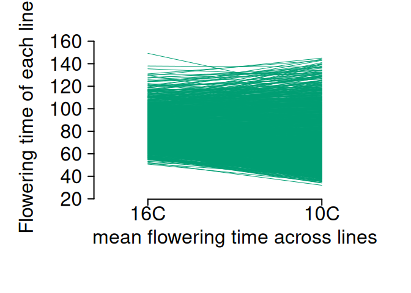
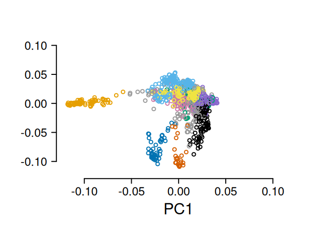
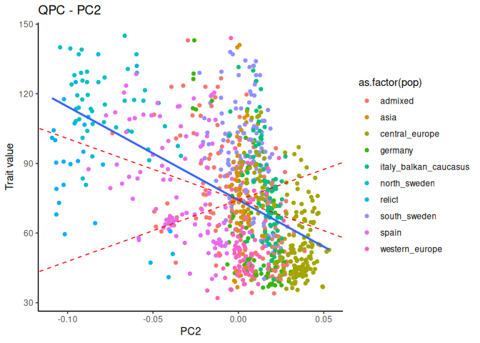
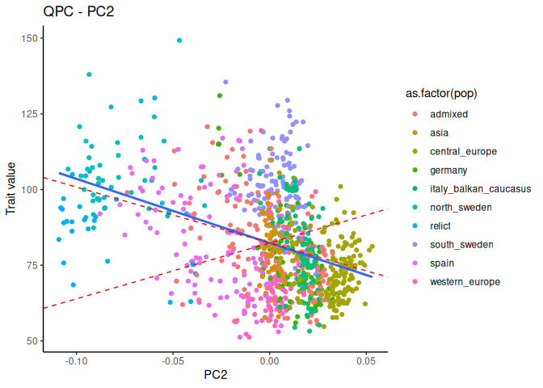
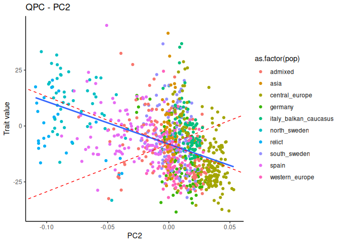
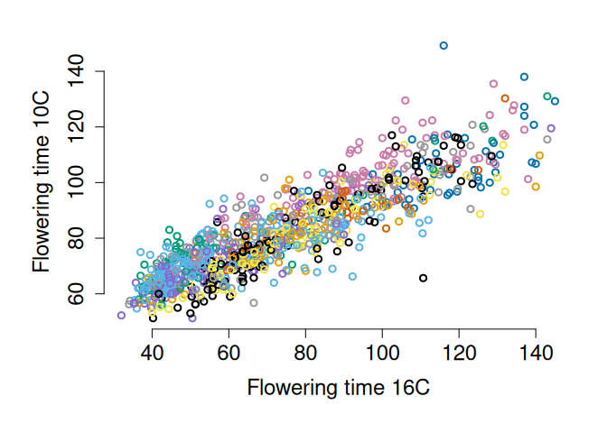
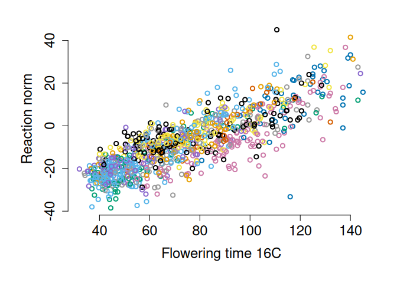
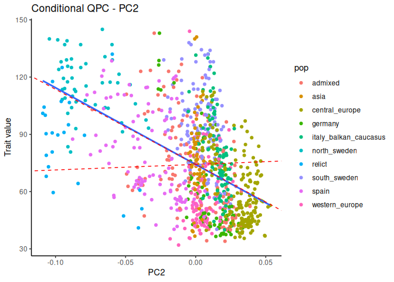
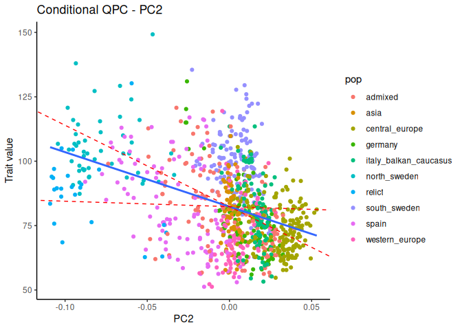

Load in data

``` r
adm = read.csv('data/1001genomes-FT10-FT16 and 1001genomes-accessions.csv')
adm_nonas = dplyr::filter(adm, FT16_mean != 'NA') #remove individuals with missing data

meanFT10 = mean(adm_nonas$FT10_mean)
meanFT16 = mean(adm_nonas$FT16_mean)

#look at reaction norms

par(mar=c(8,8,3,3), mfrow=c(1,1))
plot(-10,-10, xlim = c(0.75,2.25), ylim = c(25, 160), ylab = "", xlab = "mean flowering time across lines", bty="n", xaxt='n', yaxt='n', cex.lab=2)
axis(2, las=2, cex.lab=2, cex.axis=2, lwd=2)
axis(1, at=c(1,2), labels = c('16C','10C'), cex.lab=2, cex.axis=2, lwd=2)
mtext("Flowering time of each line", side=2, cex=2, line=5)
test = sapply(1:nrow(adm_nonas), function(x){
  points(c(1, 2), c(adm_nonas$FT10_mean[x], adm_nonas$FT16_mean[x]), type="l", col = mycol[4])
})
```

<!-- -->


``` r
#making a k matrix to go with data from both FT10 and FT16
myG = read.table('data/1001-matrix-50Ksamp', header=T)
knames = sapply( names(myG)[-1] ,  function(x){as.integer(substring(x,2))})
myGt = data.frame(id = knames, t(myG[,-1]))

#merge with trait data
myGadm = dplyr::inner_join(adm_nonas, myGt, by = "id")
myKadm = make_k(as.matrix(myGadm[,-c(1:17)]))
eigadm = eigen(myKadm)
admtData = myGadm[,1:17]
save(admtData, myKadm,eigadm, file = "data/fw_qpc_inputs.rda")
```

Look at relatedness in the Arabidopsis samples

``` r
load('data/fw_qpc_inputs.rda')
admtData$group = as.factor(admtData$group) #so they can be colored

par(mar=c(6,6,3,3))
cbPalette <- c('#999999', '#E69F00', '#56B4E9', "#009E73", "#F0E442", "#0072B2", "#D55E00", "#CC79A7")
palette(c(cbPalette, 'black', 'mediumpurple3'))
plot(eigadm$vectors[,1], eigadm$vectors[,2],col = admtData$group, lwd=2, ylab = "", yaxt="n",xlab = "PC1", cex.lab=2, cex.axis=2, xaxt="n", bty="n",xlim = c(-0.12, 0.12), ylim= c(-0.12, 0.12))
axis(1, cex.axis=1.5, lwd=2, at = c(-0.1, -0.05, 0, 0.05, 0.1))
axis(2, las=2, cex.axis=1.5, lwd=2)
```

<!-- -->

Test for flowering time at 16C and get the Bonferroni-corrected pvalues

``` r
#test for selection on flowering time at 16C
myQpc_16 = calcQpc(myZ = admtData$FT16_mean, myU = eigadm$vectors, myLambdas = eigadm$values, myM = 1:5, myL = 485:969) 
plotQPC(myQpc_16, myEig = eigadm, traitValues = admtData$FT16_mean, populationLabels = admtData$group, testPCs = 2)
```

```
## [[1]]
```

<!-- -->

``` r
myCI16 = 1.96*sqrt(var0(myQpc_16$cml)*eigadm$values) #get CIs for later
myQpc_16$pvals*length(myQpc_16$pvals) #Bonferroni corrected pvalues
```

```
## [1] 2.029116414 0.001765576 0.369807501 2.715622749 3.914836588
```


Test for selection on flowering time at 10C and get the Bonferroni-corrected pvalues

``` r
myQpc_10 = calcQpc(myZ = admtData$FT10_mean, myU = eigadm$vectors, myLambdas = eigadm$values,  myM = 1:5, myL = 485:969)
plotQPC(myQpc_10, myEig = eigadm, traitValues = admtData$FT10_mean, populationLabels = admtData$group, testPCs = 2)
```

```
## [[1]]
```

<!-- -->

``` r
myCI10 = 1.96*sqrt(var0(myQpc_10$cml)*eigadm$values) #get CIs for later
myQpc_10$pvals*length(myQpc_10$pvals)
```

```
## [1] 2.66617246 0.03427832 0.07767821 3.16738551 1.15988186
```

Test for selection on the reaction norm

``` r
#calculate the reaction norm
admtData$fw <- admtData$FT16_mean - admtData$FT10_mean

#do qpc on the reaction norm
myQpc_fw = calcQpc(myZ = admtData$fw, myU = eigadm$vectors, myLambdas = eigadm$values,  myM = 1:5, myL = 485:969)
myCIfw = 1.96*sqrt(var0(myQpc_fw$cml)*eigadm$values)
myQpc_fw$pvals*length(myQpc_fw$pvals) #p values
```

```
## [1] 3.1108457 0.1740702 4.5207241 3.6610508 2.4389781
```

``` r
plotQPC(myQpc_fw, myEig = eigadm, traitValues = admtData$fw, populationLabels = admtData$group, testPCs = 2)
```

```
## [[1]]
```

<!-- -->


``` r
##Figure for publication
postscript("figures/floweringtime.eps",height=7,width=10,paper="special",horizontal=FALSE,colormodel="cymk")
par(mar = c(4,7,4,3), mfrow=c(2,3), xpd=F)
plot.new()
legend('topleft', levels(admtData$group), pch=1, pt.lwd = 2,col = palette(), bty="n", text.width = 0.04, cex=1.75)


plot(eigadm$vectors[,2], admtData$FT16_mean[-nrow(admtData)], bty="n", col = admtData$group, lwd=2, ylab = "", yaxt="n",xlab = "PC2", cex.lab=2, cex.axis=2, xaxt="n")
axis(1, cex.axis=1.5, lwd=2)
axis(2, las=2, cex.axis=1.5, lwd=2)
mtext('Flowering time 16C',side=2, line=4, cex=1.25)
abline(lm(admtData$FT16_mean[-nrow(admtData)]~eigadm$vectors[,2]), lwd=4, col = "black")
abline(a=mean(admtData$FT16_mean), b = myCI16[2], lty=2, col='#0072B2', lwd=4)
abline(a=mean(admtData$FT16_mean), b = -myCI16[2], lty=2, col='#0072B2', lwd=4)
mtext('A', side=3, line=1, cex=2.5, adj = -0.4)


plot(eigadm$vectors[,2], admtData$FT10_mean[-nrow(admtData)], bty="n", col = admtData$group, lwd=2, ylab = "", yaxt="n",xlab = "PC2", cex.lab=2, cex.axis=2, xaxt="n")
axis(1, cex.axis=1.5, lwd=2)
axis(2, las=2, cex.axis=1.5, lwd=2)
mtext('Flowering time 10C',side=2, line=4, cex=1.25)
abline(lm(admtData$FT10_mean[-nrow(admtData)]~eigadm$vectors[,2]), lwd=4, col = "black")
abline(a=mean(admtData$FT10_mean), b = myCI10[2], lty=2, col='#0072B2', lwd=4)
abline(a=mean(admtData$FT10_mean), b = -myCI10[2], lty=2, col='#0072B2', lwd=4)
mtext('B', side=3, line=1, cex=2.5, adj = -0.4)


plot(eigadm$vectors[,2], admtData$fw[-nrow(admtData)], bty="n", col = admtData$group, lwd=2, ylab = "", yaxt="n",xlab = "PC2", cex.lab=2, cex.axis=2, xaxt="n")
axis(1, cex.axis=1.5, lwd=2)
axis(2, las=2, cex.axis=1.5, lwd=2)
mtext('FT 16C - FT 10C',side=2, line=4, cex=1.25)
abline(lm(admtData$fw[-nrow(admtData)]~eigadm$vectors[,2]), lwd=4, col = "black")
abline(a=mean(admtData$fw), b = myCIfw[2], lty=2, col='#0072B2', lwd=4)
abline(a=mean(admtData$fw), b = -myCIfw[2], lty=2, col='#0072B2', lwd=4)
mtext('C', side=3, line=1, cex=2.5, adj = -0.4)

plot(admtData$FT16_mean, admtData$FT10_mean, bty="n", lwd=2, col=admtData$group, ylab = "Flowering time 10C", xlab = "Flowering time 16C", cex=1, cex.axis=1.5, cex.lab=2)
mtext('D', side=3, line=1, cex=2.5, adj = -0.4)

plot(admtData$FT16_mean, admtData$fw, bty="n", lwd=2, col=admtData$group, xlab = "Flowering time 16C", ylab = 'FT 16C - FT 10C', cex.axis=1.5, cex.lab=2)
mtext('E', side=3, line=1, cex=2.5, adj = -0.4)

dev.off()
```

Look at correlation between flowering time traits and reaction norms

``` r
par(mar=c(6,6,2,2))
plot(admtData$FT16_mean, admtData$FT10_mean, bty="n", lwd=2, col=admtData$group, ylab = "Flowering time 10C", xlab = "Flowering time 16C", cex=1, cex.axis=1.5, cex.lab=1.5)
```

<!-- -->

``` r
plot(admtData$FT16_mean, admtData$fw, bty="n", lwd=2, col=admtData$group, xlab = "Flowering time 16C", ylab = "Reaction norm", cex.axis=1.5, cex.lab=1.5)
```

<!-- -->

``` r
cor.test(admtData$FT16_mean, admtData$FT10_mean)
```

```
## 
## 	Pearson's product-moment correlation
## 
## data:  admtData$FT16_mean and admtData$FT10_mean
## t = 58.596, df = 969, p-value < 2.2e-16
## alternative hypothesis: true correlation is not equal to 0
## 95 percent confidence interval:
##  0.8684560 0.8962362
## sample estimates:
##       cor 
## 0.8831178
```

``` r
cor.test(admtData$FT16_mean, admtData$fw)
```

```
## 
## 	Pearson's product-moment correlation
## 
## data:  admtData$FT16_mean and admtData$fw
## t = 45.184, df = 969, p-value < 2.2e-16
## alternative hypothesis: true correlation is not equal to 0
## 95 percent confidence interval:
##  0.8021332 0.8427409
## sample estimates:
##       cor 
## 0.8234889
```


Apply the conditional test.


``` r
myZFT = data.frame(ft16 = admtData$FT16_mean, ft10 = admtData$FT10_mean, stringsAsFactors = F)
myQcond16 = condQpc(myZ = myZFT, myU = eigadm$vectors, myLambdas = eigadm$values, myM = 2, myL = 485:969)

myZFT10 = data.frame(ft10 = admtData$FT10_mean,ft16 = admtData$FT16_mean, stringsAsFactors = F)
myQcond10 = condQpc(myZ = myZFT10, myU = eigadm$vectors, myLambdas = eigadm$values, myM = 2, myL = 485:969)

myQcond16$pvals
```

```
##             [,1]
## [1,] 0.006935183
```

``` r
myQcond10$pvals
```

```
##           [,1]
## [1,] 0.2442591
```

``` r
plotCondQpc(myQcond16, myEig = eigadm, traitValues = admtData$FT16_mean, populationLabels = admtData$group, testPCs = 2)
```

```
## [[1]]
```

<!-- -->

``` r
plotCondQpc(myQcond10, myEig = eigadm, traitValues = admtData$FT10_mean, populationLabels = admtData$group, testPCs = 2)
```

```
## [[1]]
```

<!-- -->


``` r
##Figure for publication
#legend('topleft', levels(admtData$group), pch=1, pt.lwd = 2,col = palette(), bty="n", text.width = 0.04, cex=1.75)

myZ = myZFT10
myU = eigadm$vectors
myLambdas = eigadm$values
myM = 2 
myL = 485:969

# get Xms for each PC (for Z1, the focal trait and Z2, the correlated trait) THESE ARE MEAN CENTERED
myX1centered = (myZ[-nrow(myZ),1]-mean(myZ[,1]))%*%myU/sqrt(myLambdas)
myX2centered = (myZ[-nrow(myZ),2]-mean(myZ[,2]))%*%myU/sqrt(myLambdas)

#get mu' for each PC

Ca12 = sum(myX1centered[myL]*myX2centered[myL])/length(myL) 
Va2 = (sum(myX2centered[myL]^2))/length(myL)
Va1 = sum(myX1centered[myL]^2)/length(myL)
mu1cond = mean(myZ[-nrow(myZ),1]) + (Ca12/Va2)*(myZ[-nrow(myZ),2] - mean(myZ[,2])) #one value for each individual
va1cond = Va1 - (Ca12^2)/Va2 

myCI = 1.96*sqrt(va1cond*eigadm$values)
mu2cond = mean(myZ[-nrow(myZ),2]) + (Ca12/Va1)*(myZ[-nrow(myZ),1] - mean(myZ[,1])) #one value for each individual
va2cond = Va2 - (Ca12^2)/Va1 
myCI2 = 1.96*sqrt(va2cond*eigadm$values)

postscript("figures/conditionaltest.eps",height=7,width=14,paper="special",horizontal=FALSE,colormodel="cymk")
par(mar = c(4,7,4,3), mfrow=c(1,2), xpd=F)


plot(eigadm$vectors[,2], myZ[-nrow(myZ),1], bty="n", col = admtData$group, lwd=3, xlab = 'PC2', ylab="",yaxt="n", xaxt="n", cex.lab = 2, cex=1.5, xlim = c(-0.15, 0.15), ylim = c(30,160))
axis(2, las=2, cex.axis=2, lwd=2)
axis(1, cex.axis=2, lwd=2)
myl = lm(mu1cond~eigadm$vectors[,2]) ##conditional expectation
#abline(myl, lwd=4, col = "navy")
abline(a=mean(myZ[,1]), b = myl$coefficients[2] + myCI[2], lty=3, col='#0072B2', lwd=4)
abline(a=mean(myZ[,1]), b = myl$coefficients[2] -myCI[2], lty=3, col='#0072B2', lwd=4)
abline(lm((myZ[-nrow(myZ),1])~eigadm$vectors[,2]), lwd=4, col = "navy")
legend('topright', c('observed','95% CIs'), col = c('navy','#0072B2'), bty="n", lwd=4, lty=c(1,3), cex=1.5)
mtext('A', side=3, line=1, cex=2.5, adj = -0.1)
mtext('Flowering time 10C', side=2, line=4, cex=2)


##the other way (trait 2 dependent on trait 1)
plot(eigadm$vectors[,2], myZ[-nrow(myZ),2], bty="n", col = admtData$group, lwd=3, xlab = 'PC2', ylab = "", yaxt="n", xaxt="n", cex.lab = 2, cex=1.5, xlim = c(-0.15, 0.15), ylim = c(30,160))
axis(2, las=2, cex.axis=2, lwd=2)
axis(1, cex.axis=2, lwd=2)
myl = lm(mu2cond~eigadm$vectors[,2]) ##conditional expectation
#abline(myl, lwd=4, col = "navy")
abline(a=mean(myZ[,2]), b = myl$coefficients[2] + myCI2[2], lty=3, col='#0072B2', lwd=4)
abline(a=mean(myZ[,2]), b = myl$coefficients[2] -myCI2[2], lty=3, col='#0072B2', lwd=4)
abline(lm((myZ[-nrow(myZ),2])~eigadm$vectors[,2]), lwd=4, col = "navy")
legend('topright', c('observed','95% CIs'), col = c('navy','#0072B2'), bty="n", lwd=4, lty=c(1,3), cex=1.5)
mtext('B', side=3, line=1, cex=2.5, adj = -0.1)
mtext('Flowering time 16C', side=2, line=4, cex=2)

dev.off()
```


