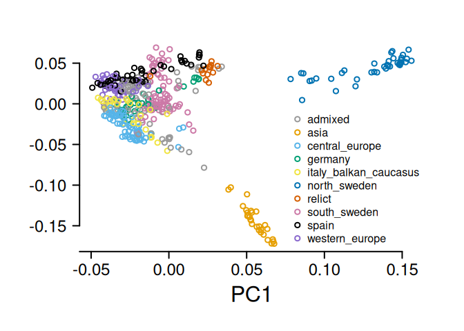
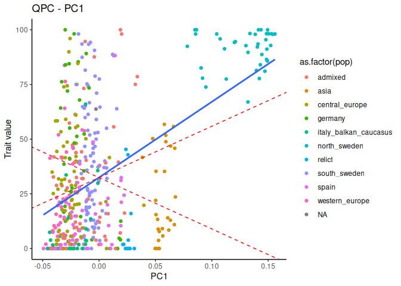
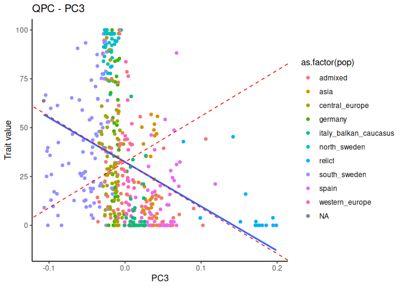
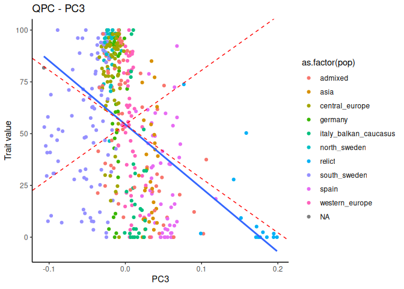
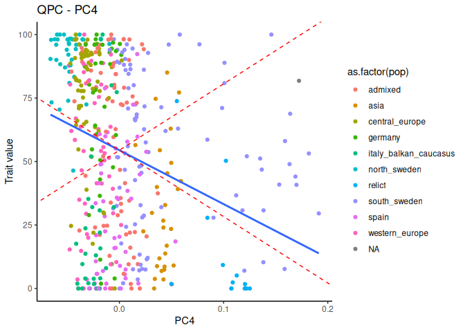
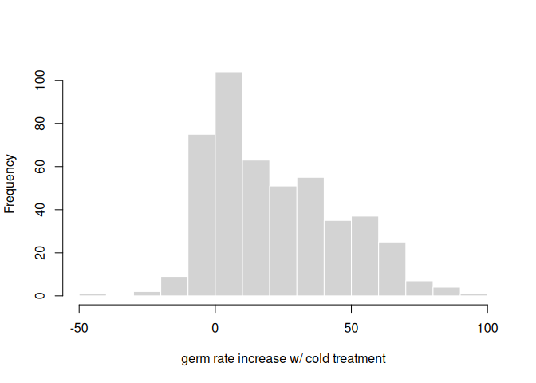
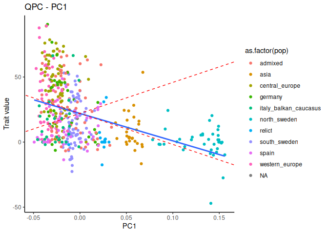
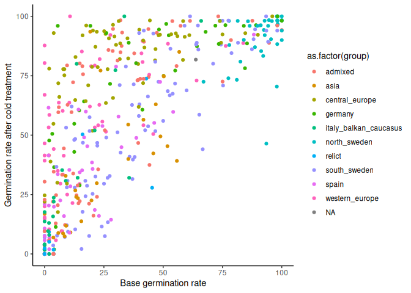
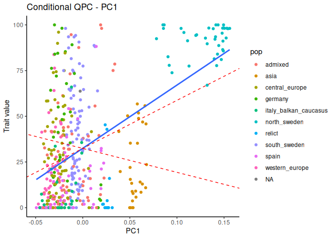

Load in data from Martinez-Berdeja et a. https://datadryad.org/dataset/doi:10.25338/B8VS4P

``` r
germ = read.csv('data/arabidopsis_germ_phen_chilling_DATA.csv')
#will use d4_4C_perc and base_perc to look at affect of chilling
```


``` r
#making a k matrix to go with data from Alejandra's experiment
myG = read.table('data/1001-matrix-50Ksamp', header=T)
knames = sapply( names(myG)[-1] ,  function(x){as.integer(substring(x,2))})
myGt = data.frame(id = knames, t(myG[,-1]))

#merge with trait data
myGg = dplyr::inner_join(germ, myGt, by = "id")
myKg = make_k(as.matrix(myGg[,-c(1:22)]))
eigg = eigen(myKg)


# merge with group data
ccinfo <- read.csv('data/1001genomes-FT10-FT16 and 1001genomes-accessions.csv') |> select(id, group, latitude, longitude, country)
gData <- dplyr::left_join(myGg[,1:22], ccinfo, by="id")

save(gData, myKg,eigg, file = "data/germ_qpc_inputs.rda")
```

Look at relatedness in the Arabidopsis samples

``` r
load('data/germ_qpc_inputs.rda')
gData$group = as.factor(gData$group) #so they can be colored

par(mar=c(6,6,3,3))
cbPalette <- c('#999999', '#E69F00', '#56B4E9', "#009E73", "#F0E442", "#0072B2", "#D55E00", "#CC79A7")
palette(c(cbPalette, 'black', 'mediumpurple3'))
plot(eigg$vectors[,1], eigg$vectors[,2],col = gData$group, lwd=2, ylab = "", yaxt="n",xlab = "PC1", cex.lab=2, cex.axis=2, xaxt="n", bty="n")
axis(1, cex.axis=1.5, lwd=2, at = c(-0.1, -0.05, 0, 0.05, 0.1,0.15))
axis(2, las=2, cex.axis=1.5, lwd=2)
legend('bottomright',levels(as.factor(gData$group)), pch=1, pt.lwd = 2,col = palette(), bty="n")
```

<!-- -->

Test for germination rate without treatment.

``` r
myQpc_germ = calcQpc(myZ = gData$base_perc, myU = eigg$vectors, myLambdas = eigg$values, myM=1:5, myL = 234:468) 

myQpc_germ$pvals
```

```
## [1] 0.00419887 0.57916859 0.02898415 0.27446304 0.26376922
```

``` r
plotQPC(myQpc_germ, myEig = eigg, traitValues = gData$base_perc, populationLabels = gData$group, testPCs = 1)
```

```
## [[1]]
```

<!-- -->

``` r
plotQPC(myQpc_germ, myEig = eigg, traitValues = gData$base_perc, populationLabels = gData$group, testPCs = 3)
```

```
## [[1]]
```

<!-- -->


Test for selection on germination rate after cold treatment

``` r
myQpc_strat = calcQpc(myZ = gData$d4_4C_perc, myU = eigg$vectors, myLambdas = eigg$values, myM=1:5, myL = 234:468) 

myQpc_strat$pvals
```

```
## [1] 0.310321224 0.991176790 0.008119587 0.036113404 0.216942240
```

``` r
plotQPC(myQpc_strat, myEig = eigg, traitValues = gData$d4_4C_perc, populationLabels = gData$group, testPCs = 3)
```

```
## [[1]]
```

<!-- -->

``` r
plotQPC(myQpc_strat, myEig = eigg, traitValues = gData$d4_4C_perc, populationLabels = gData$group, testPCs = 4)
```

```
## [[1]]
```

<!-- -->

Test for selection on the reaction norm

``` r
#calculate the reaction norm
gData$rxn <- gData$d4_4C_perc - gData$base_perc
hist(gData$rxn, main="", xlab = "germ rate increase w/ cold treatment", border="white")
```

<!-- -->

``` r
#do qpc on the reaction norm
myQpc_rxn = calcQpc(myZ = gData$rxn, myU = eigg$vectors, myLambdas = eigg$values,  myM = 1:5, myL = 234:468)
myQpc_rxn$pvals
```

```
## [1] 0.08485293 0.59345654 0.44435406 0.21839150 0.79854245
```

``` r
plotQPC(myQpc_rxn, myEig = eigg, traitValues = gData$rxn, populationLabels = gData$group, testPCs = 1)
```

```
## [[1]]
```

<!-- -->

Look at correlations

``` r
ggplot(gData, aes(x = base_perc, y = d4_4C_perc)) + 
            geom_point(aes(color = as.factor(group))) +
            theme_classic() + labs(x = "Base germination rate", y = "Germination rate after cold treatment")
```

<!-- -->

``` r
cor.test(gData$base_perc, gData$d4_4C_perc)    
```

```
## 
## 	Pearson's product-moment correlation
## 
## data:  gData$base_perc and gData$d4_4C_perc
## t = 23.767, df = 467, p-value < 2.2e-16
## alternative hypothesis: true correlation is not equal to 0
## 95 percent confidence interval:
##  0.6959670 0.7782918
## sample estimates:
##      cor 
## 0.739887
```

Apply the conditional test.


``` r
myZ = data.frame(germ = gData$base_perc, strat = gData$d4_4C_perc, stringsAsFactors = F)
myQcondgerm = condQpc(myZ = myZ, myU = eigg$vectors, myLambdas = eigg$values, myM = c(1,3,4), myL = 234:468)

myZ2 = dplyr::select(myZ, strat, germ)
myQcondstrat = condQpc(myZ = myZ2, myU = eigg$vectors, myLambdas = eigg$values, myM = c(1,3,4), myL = 234:468)

myQcondgerm$pvals
```

```
##             [,1]     [,2]      [,3]
## [1,] 0.002673554 0.186642 0.4767603
```

``` r
myQcondstrat$pvals
```

```
##           [,1]       [,2]       [,3]
## [1,] 0.2551366 0.03931591 0.03579463
```

``` r
plotCondQpc(myQcondgerm, myEig = eigg, traitValues = gData$base_perc, populationLabels = gData$group, testPCs = 1)
```

```
## [[1]]
```

<!-- -->


