Husain says: Also, I have some of those examples where the reaction norm is found to be under selection by conditional QPC but not the unconditional test. I saved it just as a list of lists, with phenos and eigen decomposition for 5 different simulation runs. The list items are labeled based on their simulation index so you can pair them.


``` r
load('example_reaction_norms.RData')


## look at first sim
i=1
mydata = cbind(data$phenos[[i]][-400,], data.frame(data$eigs[[i]]$vectors))
mydata$rxn = mydata$trait2 - mydata$trait1
mydata$mean = (mydata$trait1+mydata$trait2)/2

#check the qpc for reaction norm
myqpc = calc_qpc(mydata$rxn,data$eigs[[i]],test_pcs=1:2,var_pcs=200:399)
myqpc$pvals[2]
```

```
## [1] 0.1009515
```

``` r
mycond = calc_cond_qpc(focal_trait=mydata$rxn,cor_trait=mydata$mean,data$eigs[[i]],test_pcs=2,var_pcs=200:399)
mycond$pvals
```

```
##            [,1]
## [1,] 0.03231903
```

``` r
plot_qpc(myqpc,trait_values = mydata$rxn, eigen_k = data$eigs[[i]], test_pcs=2, pop_labels=mydata$pop)
```

```
## [[1]]
```

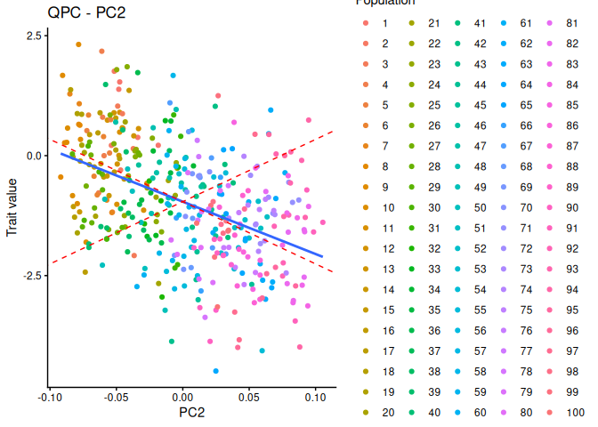<!-- -->

``` r
plot_cond_qpc(mycond,trait_values = mydata$rxn, eigen_k = data$eigs[[i]], test_pcs=2, pop_labels=mydata$pop)
```

```
## [[1]]
```

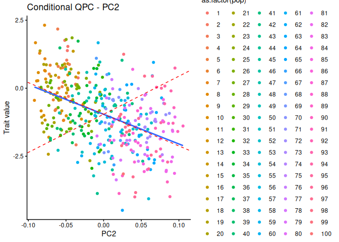<!-- -->

``` r
#what does the mean look like?
ggplot(mydata, aes(x = X2, y = mean)) + 
   geom_point() +
   stat_smooth(method = "lm", col = "darkred") +
   theme_classic()
```

```
## `geom_smooth()` using formula = 'y ~ x'
```

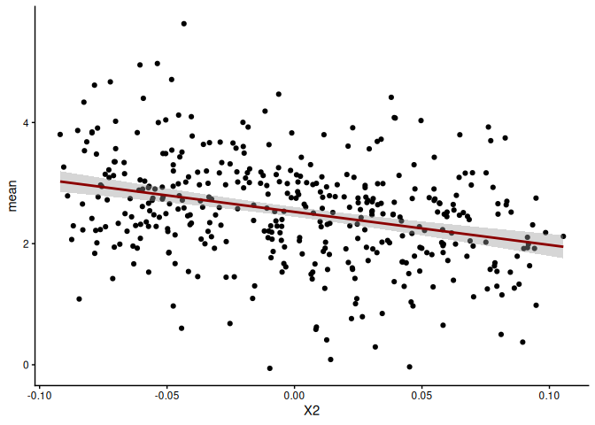<!-- -->

``` r
ggplot(mydata, aes(x = rxn, y = mean)) + 
   geom_point() +
   stat_smooth(method = "lm", col = "darkred") +
   theme_classic()
```

```
## `geom_smooth()` using formula = 'y ~ x'
```

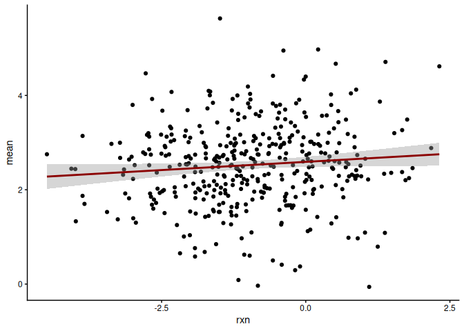<!-- -->

``` r
#how correlated are they?
cor.test(mydata$rxn, mydata$mean)
```

```
## 
## 	Pearson's product-moment correlation
## 
## data:  mydata$rxn and mydata$mean
## t = 1.9554, df = 397, p-value = 0.05123
## alternative hypothesis: true correlation is not equal to 0
## 95 percent confidence interval:
##  -0.0005082064  0.1939858628
## sample estimates:
##        cor 
## 0.09767132
```

``` r
##so what's happening to the variances?

#is va est changing?
 var0(myqpc$cml) #for qpc
```

```
## [1] 5.4563
```

``` r
 mycond$cond_va# for cond test
```

```
## [1] 5.330741
```

``` r
 #it's pretty similar
 #lambdas are the same
 
 #how are the projections changing?
 rxn_meancentered = mydata$rxn[1:399] - mean(mydata$rxn) 
rxn_meancentered %*% mydata$X2 #for qpc
```

```
##           [,1]
## [1,] -10.90809
```

``` r
 (rxn_meancentered- mycond$mu_cond)%*% mydata$X2    # for conditional test
```

```
##           [,1]
## [1,] -12.11504
```

``` r
#so the difference is that subtracting mu_cond increases the variance that loads on pc2. Why?

mydata$mu_cond = mycond$mu_cond

ggplot(mydata, aes(x = X2, y = mu_cond)) + 
   geom_point() +
   stat_smooth(method = "lm", col = "darkred") +
   theme_classic()
```

```
## `geom_smooth()` using formula = 'y ~ x'
```

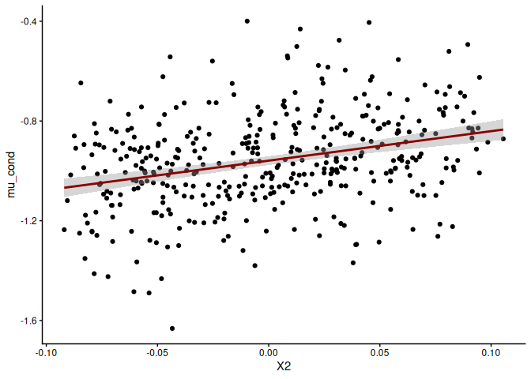<!-- -->

Try another example


``` r
## look at second sim
i=2
mydata = cbind(data$phenos[[i]][-400,], data.frame(data$eigs[[i]]$vectors))
mydata$rxn = mydata$trait2 - mydata$trait1
mydata$mean = (mydata$trait1+mydata$trait2)/2

#check the qpc for reaction norm
myqpc = calc_qpc(mydata$rxn,data$eigs[[i]],test_pcs=1:2,var_pcs=200:399)
myqpc$pvals[2]
```

```
## [1] 0.1071392
```

``` r
mycond = calc_cond_qpc(focal_trait=mydata$rxn,cor_trait=mydata$mean,data$eigs[[i]],test_pcs=2,var_pcs=200:399)
mycond$pvals
```

```
##            [,1]
## [1,] 0.04429488
```

``` r
plot_qpc(myqpc,trait_values = mydata$rxn, eigen_k = data$eigs[[i]], test_pcs=2, pop_labels=mydata$pop)
```

```
## [[1]]
```

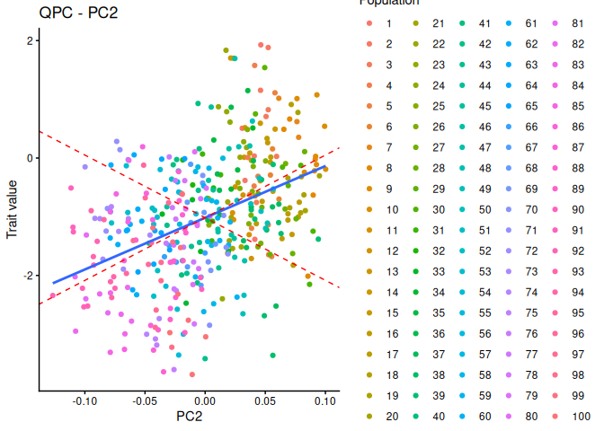<!-- -->

``` r
plot_cond_qpc(mycond,trait_values = mydata$rxn, eigen_k = data$eigs[[i]], test_pcs=2, pop_labels=mydata$pop)
```

```
## [[1]]
```

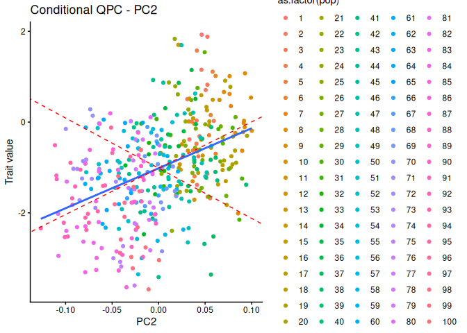<!-- -->

``` r
#what does the mean look like?
ggplot(mydata, aes(x = X2, y = mean)) + 
   geom_point() +
   stat_smooth(method = "lm", col = "darkred") +
   theme_classic()
```

```
## `geom_smooth()` using formula = 'y ~ x'
```

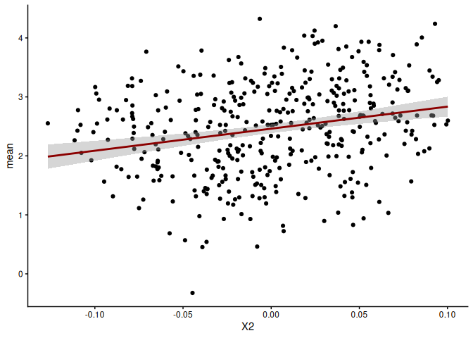<!-- -->

``` r
ggplot(mydata, aes(x = rxn, y = mean)) + 
   geom_point() +
   stat_smooth(method = "lm", col = "darkred") +
   theme_classic()
```

```
## `geom_smooth()` using formula = 'y ~ x'
```

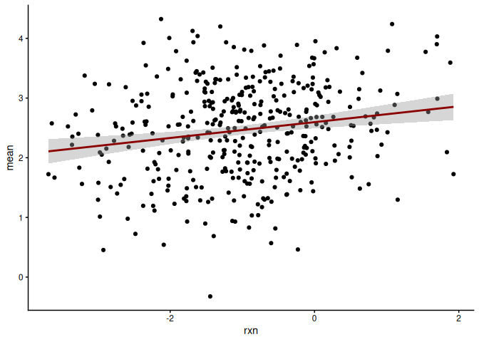<!-- -->

``` r
#is va est changing?
 var0(myqpc$cml) #for qpc
```

```
## [1] 4.106895
```

``` r
 mycond$cond_va# for cond test
```

```
## [1] 4.07581
```

``` r
 #it's pretty similar

#how are the projections changing?
 rxn_meancentered = mydata$rxn[1:399] - mean(mydata$rxn) 
rxn_meancentered %*% mydata$X2 #for qpc
```

```
##          [,1]
## [1,] 8.811767
```

``` r
 (rxn_meancentered- mycond$mu_cond)%*% mydata$X2    # for conditional test
```

```
##          [,1]
## [1,] 9.258792
```

``` r
mydata$mu_cond = mycond$mu_cond

ggplot(mydata, aes(x = X2, y = mu_cond)) + 
   geom_point() +
   stat_smooth(method = "lm", col = "darkred") +
   theme_classic()
```

```
## `geom_smooth()` using formula = 'y ~ x'
```

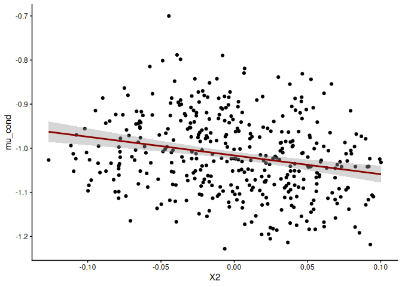<!-- -->

Try for the third one

``` r
i=3
mydata = cbind(data$phenos[[i]][-400,], data.frame(data$eigs[[i]]$vectors))
mydata$rxn = mydata$trait2 - mydata$trait1
mydata$mean = (mydata$trait1+mydata$trait2)/2

#check the qpc for reaction norm
myqpc = calc_qpc(mydata$rxn,data$eigs[[i]],test_pcs=1,var_pcs=200:399)
myqpc$pvals
```

```
## [1] 0.09337769
```

``` r
mycond = calc_cond_qpc(focal_trait=mydata$rxn,cor_trait=mydata$mean,data$eigs[[i]],test_pcs=1,var_pcs=200:399)
mycond$pvals
```

```
##            [,1]
## [1,] 0.02654914
```

``` r
plot_qpc(myqpc,trait_values = mydata$rxn, eigen_k = data$eigs[[i]], test_pcs=1, pop_labels=mydata$pop)
```

```
## [[1]]
```

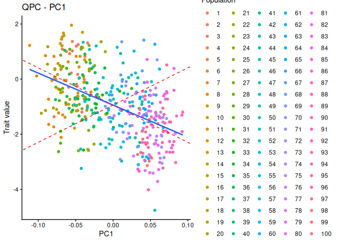<!-- -->

``` r
plot_cond_qpc(mycond,trait_values = mydata$rxn, eigen_k = data$eigs[[i]], test_pcs=1, pop_labels=mydata$pop)
```

```
## [[1]]
```

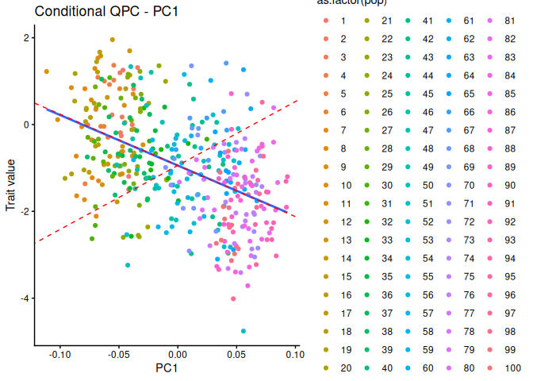<!-- -->

``` r
#what does the mean look like?
ggplot(mydata, aes(x = X2, y = mean)) + 
   geom_point() +
   stat_smooth(method = "lm", col = "darkred") +
   theme_classic()
```

```
## `geom_smooth()` using formula = 'y ~ x'
```

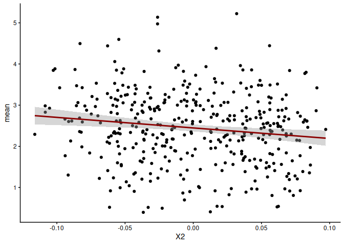<!-- -->

``` r
ggplot(mydata, aes(x = rxn, y = mean)) + 
   geom_point() +
   stat_smooth(method = "lm", col = "darkred") +
   theme_classic()
```

```
## `geom_smooth()` using formula = 'y ~ x'
```

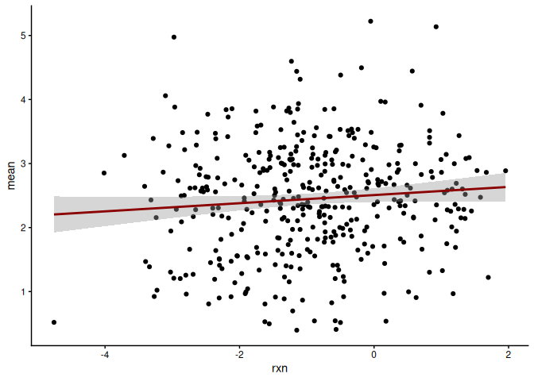<!-- -->

``` r
#is va est changing?
 var0(myqpc$cml) #for qpc
```

```
## [1] 5.458846
```

``` r
 mycond$cond_va# for cond test
```

```
## [1] 5.261039
```

``` r
 #it's pretty similar

#how are the projections changing?
 rxn_meancentered = mydata$rxn[1:399] - mean(mydata$rxn) 
rxn_meancentered %*% mydata$X1 #for qpc
```

```
##           [,1]
## [1,] -11.61793
```

``` r
 (rxn_meancentered- mycond$mu_cond)%*% mydata$X1    # for conditional test
```

```
##           [,1]
## [1,] -13.12347
```

``` r
mydata$mu_cond = mycond$mu_cond

ggplot(mydata, aes(x = X2, y = mu_cond)) + 
   geom_point() +
   stat_smooth(method = "lm", col = "darkred") +
   theme_classic()
```

```
## `geom_smooth()` using formula = 'y ~ x'
```

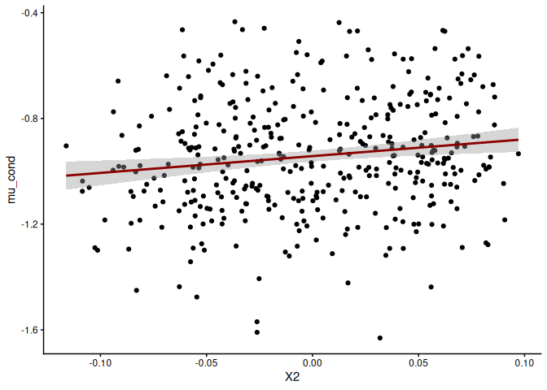<!-- -->
