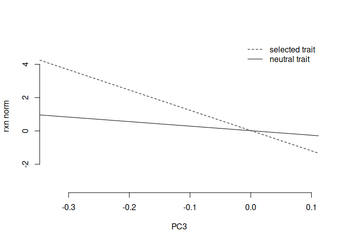

##1. Simulate neutral trait data for 2 traits that are correlated (so I decide Va and C)


``` r
#140 individuals, 2 traits
myM = matrix(0, nrow=140, ncol=2)

#make up some Vas and Cs. 
myV = matrix(c(1,.5,.5,1), nrow=2)

set.seed(333)

myZ = matrix_normal(M = myM, U = myK, V = myV)

#par(mfrow=c(1,3))
#hist(myZ[,1], col = mycol[1], border="white", breaks=10, main = "", xlab = "trait 1")
#hist(myZ[,2], col = mycol[2], border="white", breaks=10, main= "", xlab = "trait 2")
#plot(myZ[,1], myZ[,2], xlab = "trait 1", ylab = "trait 2", bty="n", col = mycol[3], lwd=2)
#cor.test(myZ[,1], myZ[,2])

par(mfrow=c(1,1))
plot(myEig$vectors[,3],myZ[,2], xlab = "PC3", ylab = "trait", col="white", bty="n") #trait under selection
abline(lm(myZ[,2]~myEig$vectors[,3]))
abline(lm(myZ[,1]~myEig$vectors[,3]), lty=2)
legend('topleft',c('neutral trait','neutral trait'),bty="n",lty=c(1,2))
```

<!-- -->

``` r
myQpc1 = calc_qpc(trait_values = myZ[,1], eigen_k = myEig, test_pcs = 1:10,var_pcs = 70:140)
myQpc2 = calc_qpc(trait_values = myZ[,2], eigen_k = myEig, test_pcs = 1:10,var_pcs = 70:140)

myQpc1$pvals[3] #neutral trait
```

```
## [1] 0.4460056
```

``` r
myQpc2$pvals[3] #neutral trait
```

```
## [1] 0.03167186
```

##2. Simulate trait data for 2 correlated traits where trait 1 is neutral and trait 2  is under selection. No selection on plasticity or the reaction norm.


``` r
tc = .6 #set trait cor
myM = matrix(0, nrow=140, ncol=2)
myV = matrix(c(1,tc,tc,1), nrow=2)

set.seed(555)
#neutral traits
myZ = matrix_normal(myM, myK, myV)

#selected traits -- could add separate selection by adding different PCs into the mix. Yes, this is hacky. But right now what I'm doing in is adding the selection effect is the position on PC3*the variance explained by PC3 on trait 2. For trait 1, I'm multiplying this by the correlation btw traits
selectionEffect = matrix(c(myEig$vectors[,3]*myEig$values[3]*tc, myEig$vectors[,3]*myEig$values[3]), nrow=140) 
myZs = myZ + selectionEffect

par(mfrow=c(1,1))
plot(myEig$vectors[,3],myZs[,2], xlab = "PC3", ylab = "trait", col="white", bty="n") #trait under selection
abline(lm(myZs[,2]~myEig$vectors[,3]))
abline(lm(myZs[,1]~myEig$vectors[,3]), lty=2)
legend('topleft',c('selected trait','neutral trait'),bty="n",lty=c(1,2))
```

<!-- -->

``` r
#par(mfrow=c(1,3))
#hist(myZs[,1], col = mycol[1], border="white", breaks=10, main = "", xlab = "trait 1")
#hist(myZs[,2], col = mycol[2], border="white", breaks=10, main= "", xlab = "trait 2")
#plot(myZs[,1], myZs[,2], xlab = "trait 1", ylab = "trait 2", bty="n", col = mycol[3], lwd=2)
#cor.test(myZ[,1], myZ[,2])


##does it work to create differences detectable by regular qpc

<<<<<<< Updated upstream
myQpc1s = calc_qpc(trait_values = myZs[,1], eigen_k = myEig, test_pcs = 1:10,var_pcs = 70:140) #neutral trait
myQpc2s = calc_qpc(trait_values = myZs[,2], eigen_k = myEig, test_pcs = 1:10,var_pcs = 70:140) #selected trait
=======
myQpc1s = calc_qpc(trait_values = c(myZs[,1], 0), eigen_k = myEig, test_pcs = 1:10, var_pcs = 70:140)
myQpc2s = calc_qpc(trait_values = c(myZs[,2], 0), eigen_k = myEig, test_pcs = 1:10, var_pcs = 70:140)
>>>>>>> Stashed changes
myQpc1s$pvals[3]
```

```
## [1] 0.02213254
```

``` r
myQpc2s$pvals[3]
```

```
## [1] 0.0004648274
```

``` r
##what does it look like from the reaction norm perspective?
myZs = data.frame(myZs)
myZs$rn = myZs[,1] - myZs[,2]

plot(myEig$vectors[,3],myZs$rn, xlab = "PC3", ylab = "rxn norm", col="white", bty="n") 
abline(lm(myZs$rn~myEig$vectors[,3]))
```

<!-- -->

``` r
calc_qpc(trait_values = myZs$rn, eigen_k = myEig, test_pcs = 1:10,var_pcs = 70:140)$pvals[3] ## so this manifests as weak selection on the reaction norm in this one case.
```

```
## [1] 0.09866403
```

##3 Now we want to simulate selection on the reaction norm


``` r
tc = .6 #set trait cor
myM = matrix(0, nrow=140, ncol=2)
myV = matrix(c(1,tc,tc,1), nrow=2)

set.seed(1221)
myZ = matrix_normal(myM, myK, myV) ## sim the neutral traits


#adding selection onto the reaction norm
myZ = data.frame(myZ)
myZ$rn = myZs[,1] - myZs[,2]
selectionEffect = myEig$vectors[,3]*7
myZ$rns = myZ$rn - selectionEffect #note need to check direction before adding

plot(myEig$vectors[,3],myZ$rns, xlab = "PC3", ylab = "rxn norm", col="white", bty="n") 
abline(lm(myZ$rn~myEig$vectors[,3]))
abline(lm(myZ$rns~myEig$vectors[,3]), lty=2)
```

<!-- -->

``` r
<<<<<<< Updated upstream
calc_qpc(trait_values = myZ$rns, eigen_k = myEig, test_pcs = 1:10,var_pcs = 70:140)$pvals[3]
=======
#is there selection on trait 1?
calc_qpc(trait_values = c(myZs[,1], 0), eigen_k = myEig, test_pcs = 1:3, var_pcs = 70:140)$pvals[3]
>>>>>>> Stashed changes
```

```
## [1] 1.087367e-08
```

``` r
<<<<<<< Updated upstream
##issue is this is separate from the trait values -- just shows we can add selection onto a reaction norm... can we make it into trait values? Imagine we hold trait 1 steady and add the reaction norm on for trait 2

myZ$trait1s = myZ[,2]+ myZ$rns


plot(myEig$vectors[,3],myZ$trait1s, xlab = "PC3", ylab = "rxn norm", col="white", bty="n") 
abline(lm(myZ[,2]~myEig$vectors[,3]))
abline(lm(myZ$trait1s~myEig$vectors[,3]), lty=2)
legend('topright',c('selected trait','neutral trait'),bty="n",lty=c(2,1))
```

<!-- -->

``` r
calc_qpc(trait_values = myZ$trait1s, eigen_k = myEig, test_pcs = 1:10,var_pcs = 70:140)$pvals[3]
```

```
## [1] 6.777753e-07
```

##R independent selection on each trait IN PROGRESS

=======
calc_qpc(trait_values = c(myZs[,2], 0), eigen_k = myEig, test_pcs = 1:3, var_pcs = 70:140)$pvals[3]
```

```
## [1] 3.260973e-05
```

``` r
#is there selection on mean?
calc_qpc((c(myZs[,1], 0)+c(myZs[,2], 0))/2, myEig, 1:3, 70:140)$pvals[3]
```

```
## [1] 0.01684066
```

``` r
#is there selection on reaction norm?
calc_qpc((c(myZs[,1], 0)-c(myZs[,2], 0)), myEig, 1:3, 70:140)$pvals[3]
```

```
## [1] 6.090026e-07
```

``` r
#How does 
calc_cond_qpc(c(myZs[,1], 0), c(myZs[,2], 0), myEig, 1:3, 70:140)$pvals[3]
```

```
## [1] 3.056339e-05
```
>>>>>>> Stashed changes
