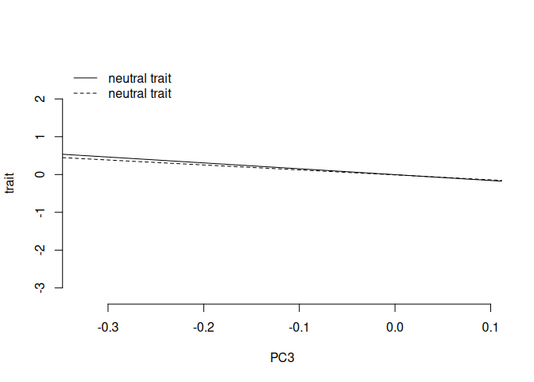
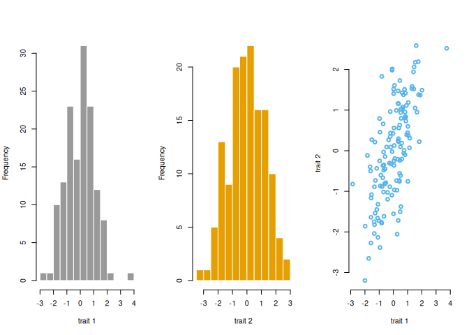
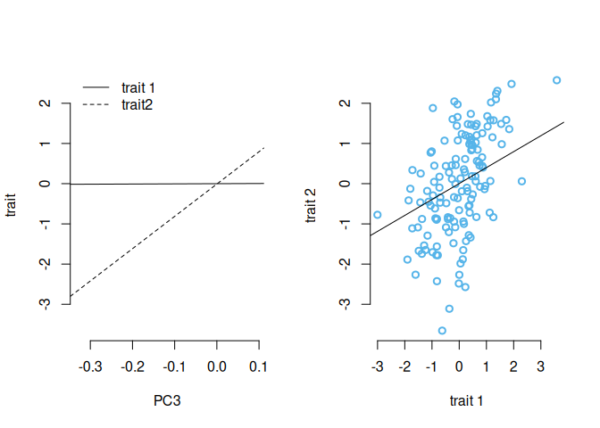

##1. Simulate neutral trait data for 2 traits that are correlated (so I decide Va and C)


``` r
#140 individuals, 2 traits
myM = matrix(0, nrow=140, ncol=2)

##pull in one of our actual kinship matrices
load('data/Norwich_qpc_inputs.rda')

#make up some Vas and Cs. 
myV = matrix(c(1,.5,.5,1), nrow=2)

set.seed(3)

myZ = matrix_normal(M = myM, U = myK, V = myV)

par(mfrow=c(1,3))
hist(myZ[,1], col = mycol[1], border="white", breaks=10, main = "", xlab = "trait 1")
hist(myZ[,2], col = mycol[2], border="white", breaks=10, main= "", xlab = "trait 2")
plot(myZ[,1], myZ[,2], xlab = "trait 1", ylab = "trait 2", bty="n", col = mycol[3], lwd=2)
```

<!-- -->

``` r
cor.test(myZ[,1], myZ[,2])
```

```
## 
## 	Pearson's product-moment correlation
## 
## data:  myZ[, 1] and myZ[, 2]
## t = 3.93, df = 138, p-value = 0.0001338
## alternative hypothesis: true correlation is not equal to 0
## 95 percent confidence interval:
##  0.1597654 0.4590034
## sample estimates:
##       cor 
## 0.3172595
```

``` r
par(mfrow=c(1,1))
plot(myEig$vectors[,3],myZ[,2], xlab = "PC3", ylab = "trait", col="white", bty="n") #trait under selection
abline(lm(myZ[,2]~myEig$vectors[,3]))
abline(lm(myZ[,1]~myEig$vectors[,3]), lty=2)
legend('topleft',c('neutral trait','neutral trait'),bty="n",lty=c(1,2))
```

<!-- -->

##2. Simulate trait data for 2 correlated traits where trait 1 is neutral and trait 2  is under selection. No selection on plasticity or the reaction norm.


``` r
tc = .6 #set trait cor
myM = matrix(0, nrow=140, ncol=2)
myV = matrix(c(1,tc,tc,1), nrow=2)

set.seed(555)
#neutral traits
myZ = matrix_normal(myM, myK, myV)

#selected traits -- could add separate selection by adding different PCs into the mix. Yes, this is hacky. But right now what I'm doing in is adding the selection effect is the position on PC3*the variance explained by PC3 on trait 2. For trait 1, I'm multiplying this by the correlation btw traits
selectionEffect = matrix(c(myEig$vectors[,3]*myEig$values[3]*tc, myEig$vectors[,3]*myEig$values[3]), nrow=140) 
myZs = myZ + selectionEffect

par(mfrow=c(1,1))
plot(myEig$vectors[,3],myZs[,2], xlab = "PC3", ylab = "trait", col="white", bty="n") #trait under selection
abline(lm(myZs[,2]~myEig$vectors[,3]))
abline(lm(myZs[,1]~myEig$vectors[,3]), lty=2)
legend('topleft',c('selected trait','neutral trait'),bty="n",lty=c(1,2))
```

<!-- -->

``` r
par(mfrow=c(1,3))
hist(myZs[,1], col = mycol[1], border="white", breaks=10, main = "", xlab = "trait 1")
hist(myZs[,2], col = mycol[2], border="white", breaks=10, main= "", xlab = "trait 2")
plot(myZs[,1], myZs[,2], xlab = "trait 1", ylab = "trait 2", bty="n", col = mycol[3], lwd=2)
```

<!-- -->

``` r
cor.test(myZ[,1], myZ[,2])
```

```
## 
## 	Pearson's product-moment correlation
## 
## data:  myZ[, 1] and myZ[, 2]
## t = 9.4973, df = 138, p-value < 2.2e-16
## alternative hypothesis: true correlation is not equal to 0
## 95 percent confidence interval:
##  0.5166893 0.7195517
## sample estimates:
##       cor 
## 0.6287001
```

``` r
##does it work to create differences detectable by regular qpc

myQpc1s = calcQpc(myZ = myZs[,1], myLambdas = myEig$values, myU = myEig$vectors, myM = 1:10, myL = 70:140)
myQpc2s = calcQpc(myZ = myZs[,2], myLambdas = myEig$values, myU = myEig$vectors, myM = 1:10, myL = 70:140)
myQpc1s$pvals[3]
```

```
## [1] 0.02213327
```

``` r
myQpc2s$pvals[3]
```

```
## [1] 0.0004651775
```

``` r
#condQpc(myZs,, myM=3,myL=70:140)
```

##3 Now we want to simulate selection on the reaction norm


``` r
tc = .6 #set trait cor
myM = matrix(0, nrow=140, ncol=2)
myV = matrix(c(1,tc,tc,1), nrow=2)

set.seed(555)
myZ = matrix_normal(myM, myK, myV) ## sim the neutral traits


#selected traits -- For trait 2, selection effect is PC3*5. For trait 1, selection effect is PC3*-5. So we have selection for different optima in each environment
selectionEffect = matrix(-c(myEig$vectors[,3]*2, -5*myEig$vectors[,3]), nrow=140) 
myZs = myZ + selectionEffect


par(mfrow=c(1,2))
plot(myEig$vectors[,3],myZs[,2], xlab = "PC3", ylab = "trait", col="white", bty="n") #trait under selection
abline(lm(myZs[,2]~myEig$vectors[,3]), lty=2)
abline(lm(myZs[,1]~myEig$vectors[,3]), lty=1)
legend('topleft',c('trait 1','trait2'),bty="n",lty=c(1,2))

plot(myZs[,1], myZs[,2], xlab = "trait 1", ylab = "trait 2", bty="n", col = mycol[3], lwd=2)
abline(lm(myZs[,1]~myZs[,2]), lty=1)
```

<!-- -->

``` r
#is there selection on trait 1?
calcQpc(myZ = myZs[,1], myLambdas = myEig$values, myU = myEig$vectors, myM = 1:3, myL = 70:140)$pvals[3]
```

```
## [1] 0.9812383
```

``` r
#is there selection on trait 2
calcQpc(myZ = myZs[,2], myLambdas = myEig$values, myU = myEig$vectors, myM = 1:3, myL = 70:140)$pvals[3]
```

```
## [1] 3.264703e-05
```

``` r
#is there selection on mean?
calcQpc(myZ = (myZs[,1]+myZs[,2])/2, myLambdas = myEig$values, myU = myEig$vectors, myM = 1:3, myL = 70:140)$pvals[3]
```

```
## [1] 0.0168443
```

``` r
#is there selection on reaction norm?
calcQpc(myZ = myZs[,1]-myZs[,2], myLambdas = myEig$values, myU = myEig$vectors, myM = 1:3, myL = 70:140)$pvals[3]
```

```
## [1] 6.095792e-07
```
