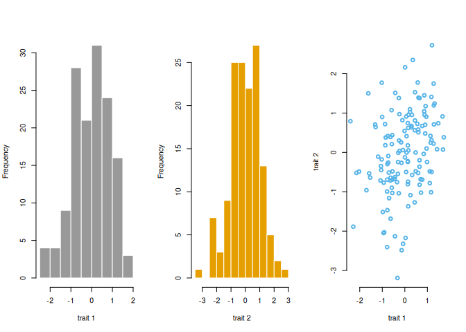
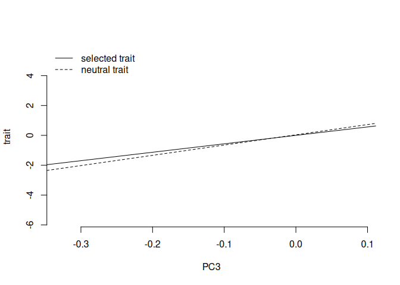

##1. Simulate neutral trait data for 2 traits that are correlated (so I decide Va and C)


``` r
#140 individuals, 2 traits
myM = matrix(0, nrow=140, ncol=2)

#make up some Vas and Cs. 
myV = matrix(c(1,.5,.5,1), nrow=2)

set.seed(333)

myZ = matrix_normal(M = myM, U = myK, V = myV)

#par(mfrow=c(1,3))
#hist(myZ[,1], col = mycol[1], border="white", breaks=10, main = "", xlab = "trait 1")
#hist(myZ[,2], col = mycol[2], border="white", breaks=10, main= "", xlab = "trait 2")
#plot(myZ[,1], myZ[,2], xlab = "trait 1", ylab = "trait 2", bty="n", col = mycol[3], lwd=2)
#cor.test(myZ[,1], myZ[,2])

par(mfrow=c(1,1))
plot(myEig$vectors[,3],myZ[,2], xlab = "PC3", ylab = "trait", col="white", bty="n") #trait under selection
abline(lm(myZ[,2]~myEig$vectors[,3]))
abline(lm(myZ[,1]~myEig$vectors[,3]), lty=2)
legend('topleft',c('neutral trait','neutral trait'),bty="n",lty=c(1,2))
```

<!-- -->

``` r
myQpc1 = calc_qpc(trait_values = myZ[,1], eigen_k = myEig, test_pcs = 1:10,var_pcs = 70:140)
myQpc2 = calc_qpc(trait_values = myZ[,2], eigen_k = myEig, test_pcs = 1:10,var_pcs = 70:140)

myQpc1$pvals[3] #neutral trait
```

```
## [1] 0.4460056
```

``` r
myQpc2$pvals[3] #neutral trait
```

```
## [1] 0.03167186
```

##2. Simulate trait data for 2 correlated traits where trait 1 is neutral and trait 2  is under selection. No selection on plasticity or the reaction norm.


``` r
tc = .4 #set trait cor
myM = matrix(0, nrow=140, ncol=2)
myV = matrix(c(1,tc,tc,1), nrow=2)

set.seed(555)
#neutral traits
myZ = matrix_normal(myM, myK, myV)

#selected traits 
selectionEffect = matrix(c(myEig$vectors[,3]*myEig$values[3],rep(0,140)), nrow=140) 
myZs = myZ + selectionEffect ## trait 1 is under s

new_traits = tibble(trait1 = myZs[,1]) |> 
  rowwise() |>
  mutate(trait2 = (tc*trait1 + sqrt(1 - tc^2)*rnorm(n = 1, mean = trait1, sd =  sqrt(1))), #this sets up trait 2 to be correlated with trait 1
  rn1 = trait1 - trait2,
  rn2 = trait2-trait1) #trait 1 is under selection

#ggplot(new_traits, aes(x = trait1, y = trait2)) + geom_point() + geom_smooth(method = "lm") + theme_classic()
cor.test(new_traits$trait1, new_traits$trait2) ##seems way too high, revisit
```

```
## 
## 	Pearson's product-moment correlation
## 
## data:  new_traits$trait1 and new_traits$trait2
## t = 16.013, df = 138, p-value < 2.2e-16
## alternative hypothesis: true correlation is not equal to 0
## 95 percent confidence interval:
##  0.7392975 0.8575021
## sample estimates:
##       cor 
## 0.8063058
```

``` r
par(mfrow=c(1,1))
plot(myEig$vectors[,3],new_traits$trait2, xlab = "PC3", ylab = "trait", col="white", bty="n") 
abline(lm(new_traits$trait1~myEig$vectors[,3])) #trait under selection
abline(lm(new_traits$trait2~myEig$vectors[,3]), lty=2)
legend('topleft',c('selected trait','neutral trait'),bty="n",lty=c(1,2))
```

<!-- -->

``` r
## why is the slope stronger for the neutral trait?

##does it work to create differences detectable by regular qpc
calc_qpc(trait_values = new_traits$trait1, eigen_k = myEig, test_pcs = 1:3,var_pcs = 70:140)$pvals[3]
```

```
## [1] 0.002453869
```

``` r
calc_qpc(trait_values = new_traits$trait2, eigen_k = myEig, test_pcs = 1:3,var_pcs = 70:140)$pvals[3]
```

```
## [1] 0.1310928
```

``` r
calc_qpc(trait_values = new_traits$rn1, eigen_k = myEig, test_pcs = 1:3,var_pcs = 70:140)$pvals[3]
```

```
## [1] 0.7504053
```

``` r
calc_qpc(trait_values = new_traits$rn2, eigen_k = myEig, test_pcs = 1:3,var_pcs = 70:140)$pvals[3]
```

```
## [1] 0.7504053
```

``` r
## in this case, get the same answer no matter how you calculate rn


calc_cond_qpc(focal_trait = new_traits$trait1, cor_trait = new_traits$trait2, eigen_k = myEig, test_pcs = 1:3,var_pcs = 70:140)$pvals[3]
```

```
## [1] 0.002928356
```

``` r
calc_cond_qpc(focal_trait = new_traits$trait2, cor_trait = new_traits$trait1, eigen_k = myEig, test_pcs = 1:3,var_pcs = 70:140)$pvals[3]
```

```
## [1] 0.4031489
```

``` r
calc_cond_qpc(focal_trait = new_traits$rn1, cor_trait = rowMeans(new_traits[,c("trait1","trait2")]), eigen_k = myEig, test_pcs = 1:3,var_pcs = 70:140)$pvals[3]
```

```
## [1] 0.01205908
```

``` r
calc_cond_qpc(focal_trait = new_traits$rn2, cor_trait = rowMeans(new_traits[,c("trait1","trait2")]), eigen_k = myEig, test_pcs = 1:3,var_pcs = 70:140)$pvals[3]
```

```
## [1] 0.01205908
```

``` r
#ok in this case you do get the same conditional test
```

##3 Now we want to simulate selection on the reaction norm


``` r
tc = .6 #set trait cor
myM = matrix(0, nrow=140, ncol=2)
myV = matrix(c(1,tc,tc,1), nrow=2)

set.seed(1221)
myZ = matrix_normal(myM, myK, myV) ## sim the neutral traits
myZ = rbind(myZ, c(0,0))

<<<<<<< Updated upstream
#adding selection onto the reaction norm
myZ = data.frame(myZ)
myZ$rn = myZs[,1] - myZs[,2]
selectionEffect = myEig$vectors[,3]*7
myZ$rns = myZ$rn - selectionEffect #note need to check direction before adding
=======
#selected traits -- For trait 2, selection effect is PC3*5. For trait 1, selection effect is PC3*-5. So we have selection for different optima in each environment
selectionEffect = matrix(-c(myEig$vectors[,3]*2, -5*myEig$vectors[,3]), nrow=141) 
myZs = myZ + selectionEffect
>>>>>>> Stashed changes

plot(myEig$vectors[,3],myZ$rns, xlab = "PC3", ylab = "rxn norm", col="white", bty="n") 
abline(lm(myZ$rn~myEig$vectors[,3]))
abline(lm(myZ$rns~myEig$vectors[,3]), lty=2)

calc_qpc(trait_values = myZ$rns, eigen_k = myEig, test_pcs = 1:10,var_pcs = 70:140)$pvals[3]

##issue is this is separate from the trait values -- just shows we can add selection onto a reaction norm... can we make it into trait values? Imagine we hold trait 1 steady and add the reaction norm on for trait 2

myZ$trait1s = myZ[,2]+ myZ$rns


plot(myEig$vectors[,3],myZ$trait1s, xlab = "PC3", ylab = "rxn norm", col="white", bty="n") 
abline(lm(myZ[,2]~myEig$vectors[,3]))
abline(lm(myZ$trait1s~myEig$vectors[,3]), lty=2)
legend('topright',c('selected trait','neutral trait'),bty="n",lty=c(2,1))

calc_qpc(trait_values = myZ$trait1s, eigen_k = myEig, test_pcs = 1:10,var_pcs = 70:140)$pvals[3]
```

##R independent selection on each trait IN PROGRESS

